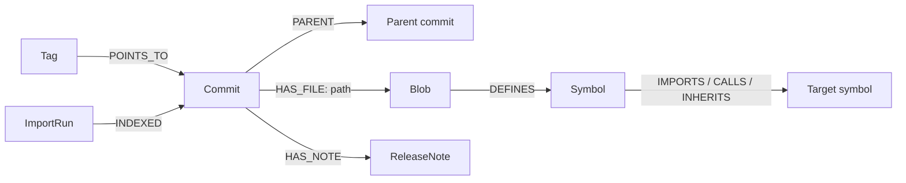
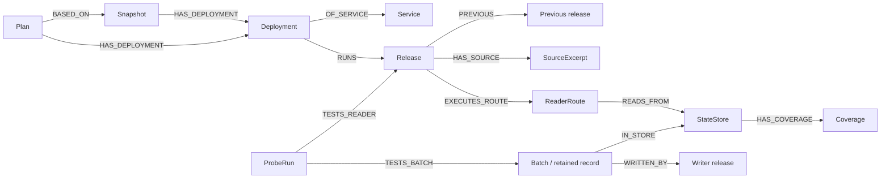

# RollbackWitness

**Rolling back code does not roll back the data it wrote.**

A Graph Hacks 2026 project for the WeMakeDevs × FalkorDB “Context for AI Agents” hackathon.

An on-call engineer asks for a behavioral rollback — *"Undo the basket rollout, but keep the receipt correction."* RollbackWitness turns that into an exact fleet of existing release artifacts (or asks a precise clarification), uses FalkorDB to find every reader that fleet will run and every retained record those readers can meet, runs the real readers on the real stored bytes, and returns one of:

- **BLOCKED** — a concrete failure witness: this reader cannot read this saved record, with the receipt and the graph path that explains why.
- **NEEDS_EVIDENCE** — no failure found, but something required is missing (coverage, writer, format, route, receipt…), listed exactly.
- **BOUNDED_PASS** — every modeled reader × record obligation has a current passing receipt. This covers **byte/shape readability of the modeled records only**, not production safety.

Only a `BOUNDED_PASS` can be approved for an idempotent **local simulation**. Nothing is ever deployed. The grounding agent and the MCP tools cannot approve; the local HTTP API is unauthenticated and trusts whoever can reach it, so the approver label is a local operator name, not a verified identity.

> The rollback workflow uses a **synthetic fixture** (Cart and Checkout services, two releases each, one cache, retained saved carts). The separate repository-evidence demo uses real pinned ItsDangerous source and an explicitly synthetic Git-revert example. Replayed runs are labeled as replays.

New to the codebase? Read the [project guide with examples and Mermaid diagrams](docs/PROJECT_GUIDE.md). The [initial issue #3 analysis](docs/ISSUE_3_ANALYSIS.md) preserves the investigation and solution options before implementation.

The separate repository-evidence demo runs on port 8127. Its setup and graph
model are documented below, with implementation details in the
[query and algorithm reference](docs/GRAPH_QUERIES.md).

The [issue #3 implementation report](docs/ISSUE_3_FIX_REPORT.md) explains the tool-call and rate-limit changes, why each was needed, and their verification results. The [historical live comparison](docs/ISSUE_3_COMPARISON.md) contains author-reported results; its raw artifacts are not committed and those numbers are not independently verifiable acceptance evidence.

For the free-tier operating choice and the browser check of the sanitized quota message, see the [issue #4 quota plan](docs/ISSUE_4_QUOTA.md).

## The thirty-second story

1. The agent grounds the request in release notes and code, cites exact quotes, and asks when the fix to keep and the change to undo live in the same artifact.
2. Proposed fleet: cart → 1.4, keep checkout 2.1. **cart 1.4 starts GREEN** — but its reader **FAILS** on `saved-cart-2002`, which cart 1.5 already wrote as `cart/v2`.
3. FalkorDB shows the evidence path: `Plan → Deployment → cart 1.4 → load_saved_cart → cart-cache ← saved-cart-2002 (cart/v2) → written by cart 1.5`. Disposition: **BLOCKED**.
4. Given that evidence, the agent proposes an existing alternative: keep cart 1.5 with `basket_v2` off. Rechecked from scratch → **BOUNDED_PASS**.
5. A human approves the local simulation; applying it twice changes nothing the second time.

## How it works

| Part | Role |
|---|---|
| Grounding agent (`src/rw/grounding.py`) | One bounded tool loop (≤ 8 turns) over fixed read-only graph tools; proposes an existing-artifact fleet or a clarification. Default model chain: Groq `openai/gpt-oss-120b`, then `qwen/qwen3.8-27b`; Gemini optional. The model never sees graph names, Cypher, probes or approval. |
| FalkorDB (`src/rw/graph.py`) | FalkorDB 6.0.2. Releases, routes, stores, retained records, snapshots, plans and receipts; fixed parameterized queries with row caps. The multi-hop obligation query decides what gets checked and supplies the witness path. |
| Trusted checker (`src/rw/verification.py`) | Cross-checks graph results against independently parsed release files and snapshot manifests, so a missing edge, conflicting record or truncated query becomes a gap instead of disappearing. Computes the disposition (FAIL dominates; any gap → NEEDS_EVIDENCE). |
| Probes (`src/rw/probes.py`, `fixtures/shop/harness/`) | Runs allowlisted fixture readers on retained bytes in a bounded subprocess; receipts are bound to the exact obligation tuple (plan, snapshot, release, codec, route, record, payload, probe spec, environment). |
| Approval & simulation (`src/rw/simulation.py`, `src/rw/api.py`) | Human approval only for BOUNDED_PASS; evidence bytes are re-verified before approval and before simulation; SQLite ledger applies each approval once. |
| UI (`src/rw/static/`) | Minimal investigation workspace: snapshot context, cited fleet proposal, scope confirmation, startup-vs-reader verdict, connected evidence and receipt inspector, candidate comparison, and eligible human-approved simulation. Separate browser modules and CSS; no frontend build step. See [docs/UI.md](docs/UI.md). |

## Quickstart

Prerequisites: Git, Docker with Compose v2 and a running Docker daemon, and
[`uv`](https://docs.astral.sh/uv/). The setup script creates `.venv`, selects
Python 3.12 and installs pinned dependencies. Run commands from the repository
root. No frontend build is required.

```sh
git clone https://github.com/Ep1cGaimer/FalkorDB_agent.git rollbackwitness
cd rollbackwitness
```

Choose the workflow you want to run:

| Workflow | Open | Model key needed? | Data |
| --- | --- | --- | --- |
| Repository evidence demo | `http://127.0.0.1:8127` | No | Real pinned Python source plus synthetic Git history |
| Rollback console | `http://127.0.0.1:8000` | Yes for live grounding; no for operator-specified fleet or deterministic smoke | Synthetic shop releases and retained records |

### Repository evidence demo — Linux / WSL

Use a dedicated database on local port 55688, separate from the fixture database
on 6379. The container creation command below is for a **first launch**; if that
container already exists, use `docker start rw-hackathon-demo-20261018` and check
its port mapping instead. Choose another fixed port if 55688 is occupied and
update every `RW_FALKORDB_PORT` value accordingly.

```sh
sh scripts/setup.sh
mkdir -p artifacts/repos
# Skip this clone if the bare repository already exists:
git clone --bare https://github.com/pallets/itsdangerous.git artifacts/repos/itsdangerous
docker run -d --name rw-hackathon-demo-20261018 --memory=2g \
  -p 127.0.0.1:55688:6379 \
  falkordb/falkordb:6.0.2@sha256:107455e862a824e45e8e9f5a7fbfdf5e00a08b14e13eae2577c72fd9e3f59ba6
# Wait for PONG before continuing:
docker exec rw-hackathon-demo-20261018 redis-cli ping
RW_FALKORDB_PORT=55688 .venv/bin/python scripts/hackathon_demo.py setup
RW_FALKORDB_PORT=55688 .venv/bin/python scripts/hackathon_demo.py smoke
RW_FALKORDB_PORT=55688 .venv/bin/python scripts/hackathon_demo.py serve --port 8127
```

Open `http://127.0.0.1:8127` and ask **What does TimedSerializer depend on?**
Then try **Explore a real dependency chain**, open a source citation, and compare
**Inspect the fix** with **Catch the reverted fix**. The smoke command should
report `PASS` and prepares an explicitly labeled recorded backup. This is live
**deterministic retrieval**, not an LLM-generated conversation. The real source is
pinned to ItsDangerous commit `096c8d42545d3b68ea21a4f890fb2b2d8979c0bd`.

Setup generates local indexes and artifacts; they are not included in a fresh
clone. Keep the bare clone for source verification. Stop the server with Ctrl+C;
stop this dedicated database with `docker stop rw-hackathon-demo-20261018`.
For the underlying queries, a read-only example and evidence boundaries, see the
[query and algorithm reference](docs/GRAPH_QUERIES.md).

### Rollback workflow — Linux / WSL

```sh
sh scripts/setup.sh
docker compose up -d --wait
.venv/bin/python scripts/smoke.py
# Deterministic operator-specified fleet; no model call:
.venv/bin/python scripts/investigate.py --fleet cart=1.4 --confirm-as you
# Console; live grounding requires the optional key configuration below:
.venv/bin/python scripts/serve.py
```

The fleet example is expected to be `BLOCKED`: cart 1.4 cannot decode a retained
`cart/v2` record. The smoke script exercises real graph queries and fixture-reader
probes with fixed grounding; it does not call a model. The console listens at
`http://127.0.0.1:8000`. Stop it with Ctrl+C; `docker compose stop` stops the fixture
database. Do not stop another workflow's database during a recording.

For optional live grounding, copy `.env.example` to the ignored `.env` and set
`GROQ_API_KEY` locally. Do not commit that file. See
[provider configuration](docs/QUICKSTART.md#6-live-grounding-optional) for model
selection and provider limits. Keep the local UI bound to loopback.

### Windows and further checks

Full instructions: [docs/QUICKSTART.md](docs/QUICKSTART.md). Short version (Windows shown; `sh scripts/setup.sh` on Linux/macOS/Git Bash):

```powershell
docker compose up -d --wait                                       # FalkorDB 6.0.2 on 127.0.0.1:6379, waits until healthy
powershell -ExecutionPolicy Bypass -File scripts\setup.ps1         # .venv with Python 3.12 via uv
.venv\Scripts\python.exe -m pytest -q -m "not live"               # offline test suite
.venv\Scripts\python.exe scripts\smoke.py                          # end-to-end check, no model key needed
```

Try it:

```powershell
# Operator-specified fleet, no agent involved (shows BLOCKED with the witness):
.venv\Scripts\python.exe scripts\investigate.py --fleet cart=1.4 --confirm-as you

# Live agent (needs GROQ_API_KEY in .env):
.venv\Scripts\python.exe scripts\investigate.py "Undo the basket rollout, but keep the receipt correction." --confirm-as you

# Web UI on http://127.0.0.1:8000 (live or replay of saved runs; snapshot selector for NEEDS_EVIDENCE cases):
.venv\Scripts\python.exe scripts\serve.py
```

## Graph data model

The two workflows use separate graphs. FalkorDB stores evidence and relationships;
it does not store or execute the agent's workflow. Queries and graph algorithms
are documented in [GRAPH_QUERIES.md](docs/GRAPH_QUERIES.md), with implementation
links, parameters, examples and limitations.

### Repository evidence graph

Implemented by [`src/rw/repo/index.py`](src/rw/repo/index.py) and
[`src/rw/repo/query.py`](src/rw/repo/query.py). The dedicated demo uses graphs
`rw_hackathon_demo_real` and `rw_hackathon_demo_trap`. Generic repository imports
default to `rw_repo_<config.name>` unless explicitly overridden.



| Node | Important properties / purpose |
| --- | --- |
| `Repository` | Name, local Git path, status, generation and published import ID; metadata governs which import is usable |
| `ImportRun` | ID, repository, status, timestamps and metrics; only the current complete publication is queried |
| `Commit` | Full SHA, repository and commit metadata; `PARENT` points to earlier commits |
| `Tag` | Name and message; alias pointing to a commit, not immutable identity |
| `Blob` | SHA-256 content hash, Git blob identity and extraction metadata; `HAS_FILE.path` supplies the revision-specific path |
| `Symbol` | ID, qualified name, kind and source span for definitions; unresolved external targets can lack a local definition |
| `ReleaseNote` | ID, path and content hash for configured release-note files |

`IMPORTS`, `CALLS` and `INHERITS` edges record provenance and extractor identity.
Parsed and statically inferred relationships are labeled separately. A citation
contains repository, commit, path, line range and content hash; opening it verifies
the Git bytes. Example: follow `URLSafeTimedSerializer → TimedSerializer →
Serializer` at the pinned ItsDangerous revision. Python performs the bounded
relationship walk over facts retrieved from FalkorDB; this is not a claim about
runtime dispatch or behavioral compatibility.

### Rollback evidence graph

Implemented by [`src/rw/graph.py`](src/rw/graph.py). The diagram shows the principal
evidence paths; the complete property and relationship reference is in
[ARCHITECTURE.md](docs/ARCHITECTURE.md#graph-schema).



| Node group | Identity and evidence |
| --- | --- |
| `Service`, `Deployment`, `Release` | Exact service/release selection, flags, artifact and codec hashes; candidate deployments belong to a plan |
| `SourceExcerpt`, `ReaderRoute` | Release-bound source spans and content hashes; reader entry point, domain and route-contract hash |
| `Snapshot`, `StateStore`, `Batch`, `Coverage` | Snapshot manifest, store, record/payload identity, known format, writer relationship and inventory completeness |
| `Plan`, `ProbeRun` | Fleet/plan identity, obligation-bound probe receipts and `PASS` / `FAIL` / `UNKNOWN` results |

Fixture nodes have server-controlled scope and logical IDs. Release versions and
record display names alone are not sufficient identity. `Batch` is the graph
label used for a retained record. Missing writer/format/coverage facts remain
unknown; they are not inferred from a service call graph.

For example, a candidate plan selects cart 1.4, whose reader reaches the cache
containing a record written by cart 1.5. The multi-hop obligation query identifies
that reader × record pair; the actual reader probe fails on `cart/v2`, giving
`BLOCKED`. Graph traversal selects evidence and obligations; trusted code and
probe receipts determine the disposition.

## Cypher queries and graph algorithms

Read [the query and algorithm reference](docs/GRAPH_QUERIES.md) for the actual
queries the product depends on. It includes:

- Rollback obligations: `Plan → Deployment → Release → ReaderRoute → StateStore
  ← Batch → writer Release`, with snapshot filtering and optional writer evidence.
- Version-linked source retrieval through a bounded `PREVIOUS` release chain.
- Published repository revision lookup and provenance-bearing symbol relationships.
- Bounded Python dependency/dependent traversal, Git ancestry and content-based
  fix-presence checking, plus completeness and receipt validation.
- A runnable read-only example against the initialized demo graphs.

These are implemented operations, not proposed schema or generated Cypher.
The model does not supply arbitrary queries. A truncated result or absent
relationship is not sufficient evidence of completeness or safety.

## Local MCP tools

Install the optional bridge with `sh scripts/setup.sh --mcp` (PowerShell: `scripts\setup.ps1 -Mcp`).
Start the existing HTTP API with `scripts/serve.py`; a stdio host then launches `scripts/serve_mcp.py`
using absolute interpreter/script paths. Six tools start, list and read investigations/transcripts,
answer a clarification and request an alternative. Human scope confirmation, approval and local
simulation remain in the console through the returned review URL. See [docs/MCP.md](docs/MCP.md)
for host configuration, strict inputs, size/time limits and restart/retry behavior.

## Evidence and honest limits

- **Independent oracle:** 8 hand-derived cases (`evals/expected/`) — the real pipeline on real FalkorDB matches all 8 (disposition, exact obligations, probe results, gaps).
- **Relational control:** SQL joins over the same raw facts reproduce the same obligation sets in 8/8 cases — a **tie**. The graph's contribution here is the connected query that drives what the agent checks and the inspectable evidence path, not exclusivity.
- **Live grounding:** the full live eval for issue #2 matched the expected outcome kind in **11/15** observations (case-level detail in [docs/STATUS.md](docs/STATUS.md)); the vague "from last week" request still guesses instead of clarifying (issue #17). The equal-information LLM control comparison has only author-reported live results so far — see the [issue #3 implementation report](docs/ISSUE_3_FIX_REPORT.md).
- **Scope:** synthetic fixture; BOUNDED_PASS is byte/shape readability of modeled records only; readers are trusted, reviewed fixture code (the probe harness is failure containment, not a sandbox); local simulation only.

## Repository layout

```text
src/rw/            product: contracts, graph, verification, probes, grounding, pipeline, api, simulation, static UI
tests/             unit, integration (live FalkorDB) and acceptance tests
fixtures/shop/     synthetic releases (code + changelogs), snapshots, retained payloads, probe harness
evals/             independent expected outcomes, SQL and LLM controls, grounding eval runner, reviews
scripts/           setup, smoke, investigate (CLI), serve (UI), fixture builder
docs/              QUICKSTART, CONTRACTS, ARCHITECTURE, STATUS, UI, MCP, PROJECT_GUIDE, issue #3/#4 reports
```

Design questions and known gaps are tracked as repository issues (see GitHub Issues). HiveMind is a separate project; this repository does not build it.
