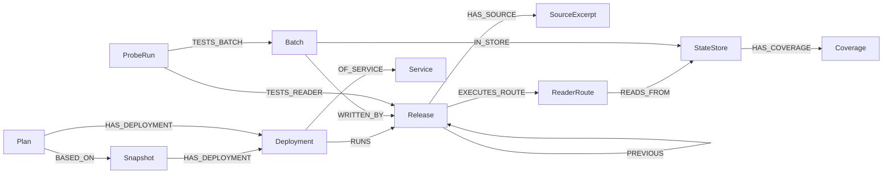

# RollbackWitness

**Rolling back code does not roll back the data it wrote.**

A Graph Hacks 2026 project for the WeMakeDevs × FalkorDB “Context for AI Agents” hackathon. **Track: Agents That Act on Connected Data.**

An on-call engineer asks for a behavioral rollback — *"Undo the basket rollout, but keep the receipt correction."* RollbackWitness turns that into an exact fleet of existing release artifacts (or asks a precise clarification), uses FalkorDB to find every reader that fleet will run and every retained record those readers can meet, runs the real readers on the real stored bytes, and returns one of:

- **BLOCKED** — a concrete failure witness: this reader cannot read this saved record, with the receipt and the graph path that explains why.
- **NEEDS_EVIDENCE** — no failure found, but something required is missing (coverage, writer, format, route, receipt…), listed exactly.
- **BOUNDED_PASS** — every modeled reader × record obligation has a current passing receipt. This covers **byte/shape readability of the modeled records only**, not production safety.

Only a `BOUNDED_PASS` can be approved for an idempotent **local simulation**. Nothing is ever deployed. The grounding agent and the MCP tools cannot approve; the local HTTP API is unauthenticated and trusts whoever can reach it, so the approver label is a local operator name, not a verified identity.

> All data is a **synthetic fixture** (Cart and Checkout services, two releases each, one cache, retained saved carts). Replayed agent runs are labeled as replays.

New to the codebase? Read the [project guide with examples and Mermaid diagrams](docs/PROJECT_GUIDE.md). The [initial issue #3 analysis](docs/ISSUE_3_ANALYSIS.md) preserves the investigation and solution options before implementation.

The [issue #3 implementation report](docs/ISSUE_3_FIX_REPORT.md) explains the tool-call and rate-limit changes, why each was needed, and their verification results. The [historical live comparison](docs/ISSUE_3_COMPARISON.md) contains author-reported results; its raw artifacts are not committed and those numbers are not independently verifiable acceptance evidence.

For the free-tier operating choice and the browser check of the sanitized quota message, see the [issue #4 quota plan](docs/ISSUE_4_QUOTA.md).

## The thirty-second story

1. The agent grounds the request in release notes and code, cites exact quotes, and asks when the fix to keep and the change to undo live in the same artifact.
2. Proposed fleet: cart → 1.4, keep checkout 2.1. **cart 1.4 starts GREEN** — but its reader **FAILS** on `saved-cart-2002`, which cart 1.5 already wrote as `cart/v2`.
3. FalkorDB shows the evidence path: `Plan → Deployment → cart 1.4 → load_saved_cart → cart-cache ← saved-cart-2002 (cart/v2) → written by cart 1.5`. Disposition: **BLOCKED**.
4. Given that evidence, the agent proposes an existing alternative: keep cart 1.5 with `basket_v2` off. Rechecked from scratch → **BOUNDED_PASS**.
5. A human approves the local simulation; applying it twice changes nothing the second time.

## How it works

| Part | Role |
|---|---|
| Grounding agent (`src/rw/grounding.py`) | One bounded tool loop (≤ 8 turns) over fixed read-only graph tools; proposes an existing-artifact fleet or a clarification. Default model chain: Groq `openai/gpt-oss-120b`, then `qwen/qwen3.8-27b`; Gemini optional. The model never sees graph names, Cypher, probes or approval. |
| FalkorDB (`src/rw/graph.py`) | FalkorDB 6.0.2. Releases, routes, stores, retained records, snapshots, plans and receipts; fixed parameterized queries with row caps. The multi-hop obligation query decides what gets checked and supplies the witness path. |
| Trusted checker (`src/rw/verification.py`) | Cross-checks graph results against independently parsed release files and snapshot manifests, so a missing edge, conflicting record or truncated query becomes a gap instead of disappearing. Computes the disposition (FAIL dominates; any gap → NEEDS_EVIDENCE). |
| Probes (`src/rw/probes.py`, `fixtures/shop/harness/`) | Runs allowlisted fixture readers on retained bytes in a bounded subprocess; receipts are bound to the exact obligation tuple (plan, snapshot, release, codec, route, record, payload, probe spec, environment). |
| Approval & simulation (`src/rw/simulation.py`, `src/rw/api.py`) | Human approval only for BOUNDED_PASS; evidence bytes are re-verified before approval and before simulation; SQLite ledger applies each approval once. |
| UI (`src/rw/static/`) | Minimal investigation workspace: snapshot context, cited fleet proposal, scope confirmation, startup-vs-reader verdict, connected evidence and receipt inspector, candidate comparison, and eligible human-approved simulation. Separate browser modules and CSS; no frontend build step. See [docs/UI.md](docs/UI.md). |

## Demo and results (18 Oct 2026)

**Demo video:** see the submission link. **Demo scenario:** `fixtures/astronomy-shop`, a synthetic model of the OpenTelemetry Astronomy Shop. checkout 3.2.0 writes non-USD orders to the Kafka `orders` topic; accounting and fraud-detection 3.1.0 only read USD. Rolling all three back to 3.1.0 is **unsafe** (every build starts GREEN, but 32 of 80 reader checks fail on orders already in the topic). Rolling back only checkout is **safe** (80/80 pass). The agent is also usable from Claude Code through the MCP server (`scripts/serve_mcp.py`, see [docs/MCP.md](docs/MCP.md)).

Run it: `$env:RW_FIXTURE="astronomy-shop"; .venv\Scripts\python.exe scripts\serve.py`, then open http://127.0.0.1:8000.

Live results, same model (`gemini-3-flash`) on both sides, small samples on synthetic data. These are indications, not statistically meaningful benchmarks:

| Comparison | RollbackWitness (graph + checker) | Control without the graph |
|---|---|---|
| Shop rollback, equal-information LLM control with the same probe tool (3 runs each) | 3/3 correct, evidence-backed; 0 unsupported "safe" claims | 1/3 correct; 1 "safe" claim without probing a required reader; 1 no answer |
| Astronomy Shop, LLM given every file as plain text (6 cases × 3 runs) | 6/6 cases correct | 15/18; on an incomplete order inventory it said "safe" 2/3 times |
| Request grounding (5 cases × 3 runs) | 13/15 matched the expected proposal/clarification | n/a |
| SQL joins over the same raw facts (8 hand-derived cases) | 8/8 | 8/8 (a tie: the graph is not exclusive; it drives the agent and supplies the visible evidence path) |

## Graph data model

FalkorDB 6.0.2, one graph per fixture (`rw_fixture_shop` for `fixtures/shop`). Everything is imported from the fixture files by `graph.reset_and_import`; plans and probe receipts are written back during an investigation.



| Node | What it is | Key properties |
|---|---|---|
| `Service` | A service in the fleet (cart, checkout) | `id`, `name` |
| `Release` | One existing build artifact | `id` (artifact hash), `service`, `version`, `built_at`, `codec_hash`, `codec_path`, `bundle_id`, declared flags |
| `SourceExcerpt` | A changelog bullet or a top-level code `def` of a release | `kind`, `path`, `line_start`/`line_end`, `text`, `content_hash` |
| `Snapshot` | The captured state of an environment (what runs, what is stored) | `id`, manifest hash |
| `Deployment` | "service X runs release Y with flags F" — in a snapshot or in a candidate plan | `service`, `version`, `flags_json` |
| `Plan` | A candidate rollback fleet proposed by the agent (or an operator) | `id`, plan hash, request, origin |
| `ReaderRoute` | A code path in a release that reads retained state | `name`, `entry`, `read_domain`, `route_contract_hash` |
| `StateStore` | A store holding data that survives a rollback (e.g. `cart-cache`) | `id`, `kind` |
| `Coverage` | Whether the snapshot inventory of a store is complete | `status` (`COMPLETE` / partial), `inventory_id_hash` |
| `Batch` | A retained record in a store, with its bytes | `record_id`, `format_id`, `payload_hash`, `payload_path`, `snapshot_id` |
| `ProbeRun` | A receipt from running a reader on a record's real bytes | `result` (PASS/FAIL/…), `obligation_hash`, `plan_hash`, `receipt_json` |

The question the graph answers: **for this candidate plan, which reader will execute, which retained records can it meet, and who wrote them?** That is the path `Plan → Deployment → Release → ReaderRoute → StateStore ← Batch → writer Release`.

## Cypher the product depends on

All queries are fixed and parameterized (`src/rw/graph.py`); the model never writes Cypher. Each read is capped at 200 rows (`LIMIT $limit` fetches cap+1), and a capped result is reported as truncated, never as complete.

**1. Obligations — what must be checked for this plan** (`obligation_paths`, `src/rw/graph.py:915`). Every row is one reader × retained-record obligation; the probe runner executes exactly these, and the row is the witness path shown for a BLOCKED verdict.

```cypher
MATCH (p:Plan {id: $plan_id})-[:HAS_DEPLOYMENT]->(d:Deployment)-[:RUNS]->(r:Release)
      -[:EXECUTES_ROUTE]->(rt:ReaderRoute)-[:READS_FROM]->(s:StateStore)
      <-[:IN_STORE]-(b:Batch {snapshot_id: $snapshot_id})
OPTIONAL MATCH (b)-[:WRITTEN_BY]->(w:Release)
RETURN p.id AS plan_id, d.id AS deployment_id, r.service AS service, r.id AS release_id,
       r.codec_hash AS codec_hash, rt.id AS route_id, s.id AS store_id, b.id AS batch_id,
       b.record_id AS record_id, b.payload_hash AS payload_hash, b.format_id AS format_id,
       w.id AS writer_release_id, w.version AS writer_version
ORDER BY d.id, b.record_id
LIMIT $limit
```

**2. Reader routes of a plan** (`plan_reader_routes`, `:820`). `OPTIONAL MATCH` keeps a deployment with a missing release, route or store visible, so the checker reports a gap (`NEEDS_EVIDENCE`) instead of silently checking fewer things.

```cypher
MATCH (p:Plan {id: $plan_id})-[:HAS_DEPLOYMENT]->(d:Deployment)
OPTIONAL MATCH (d)-[:RUNS]->(r:Release)
OPTIONAL MATCH (r)-[:EXECUTES_ROUTE]->(rt:ReaderRoute)
OPTIONAL MATCH (rt)-[:READS_FROM]->(st:StateStore)
RETURN d.service AS service, r.id AS release_id, r.codec_path AS codec_path,
       rt.id AS route_id, rt.entry AS entry, rt.read_domain AS read_domain, st.id AS store_id
ORDER BY d.service, rt.name
LIMIT $limit
```

**3. Release history with source — the agent's grounding tool** (`release_history`, `:698`). Walks the `PREVIOUS` chain from the running build and returns each release's changelog and code excerpts, which the agent must quote verbatim to justify a proposal.

```cypher
MATCH (s:Snapshot {id: $snapshot_id})-[:HAS_DEPLOYMENT]->(d:Deployment {service: $service})-[:RUNS]->(r:Release)
MATCH path = (r)-[:PREVIOUS*0..10]->(p:Release)
WITH p, length(path) AS depth WHERE depth <= $max_depth
OPTIONAL MATCH (p)-[:HAS_SOURCE]->(e:SourceExcerpt)
WITH p, depth, e ORDER BY depth, e.path, e.line_start
RETURN p.id AS release_id, p.version AS version, depth,
       collect({excerpt_id: e.id, kind: e.kind, path: e.path, text: e.text}) AS excerpts
ORDER BY depth
LIMIT $limit
```

**4. Who reads a store** (`store_readers`, `:798`) — another agent tool, used to find every release that would be affected by data in a store.

```cypher
MATCH (st:StateStore {id: $store_id})<-[:READS_FROM]-(rt:ReaderRoute)<-[:EXECUTES_ROUTE]-(r:Release)
OPTIONAL MATCH (d:Deployment)-[:RUNS]->(r)
OPTIONAL MATCH (sn:Snapshot)-[:HAS_DEPLOYMENT]->(d)
RETURN r.id AS release_id, r.service AS service, r.version AS version, rt.id AS route_id,
       rt.entry AS entry, collect(DISTINCT sn.id) AS currently_deployed_in
ORDER BY r.id, rt.id
LIMIT $limit
```

Store inventory (`store_inventory`, `:857`) and receipt read-back (`receipts_by_id`, `:1066`) complete the loop. Probe receipts are written with `MERGE (pr:ProbeRun …)-[:TESTS_READER]->(release)` / `-[:TESTS_BATCH]->(batch)` (`write_receipt`, `:1009`). Queries 3–4 are shown slightly abbreviated in their `RETURN` lists; the source has the full column set.

## Quickstart

Full instructions: [docs/QUICKSTART.md](docs/QUICKSTART.md). Short version (Windows shown; `sh scripts/setup.sh` on Linux/macOS/Git Bash):

```powershell
docker compose up -d --wait                                       # FalkorDB 6.0.2 on 127.0.0.1:6379, waits until healthy
powershell -ExecutionPolicy Bypass -File scripts\setup.ps1         # .venv with Python 3.12 via uv
.venv\Scripts\python.exe -m pytest -q -m "not live"               # offline test suite
.venv\Scripts\python.exe scripts\smoke.py                          # end-to-end check, no model key needed
```

Try it:

```powershell
# Operator-specified fleet, no agent involved (shows BLOCKED with the witness):
.venv\Scripts\python.exe scripts\investigate.py --fleet cart=1.4 --confirm-as you

# Live agent (needs GROQ_API_KEY in .env):
.venv\Scripts\python.exe scripts\investigate.py "Undo the basket rollout, but keep the receipt correction." --confirm-as you

# Web UI on http://127.0.0.1:8000 (live or replay of saved runs; snapshot selector for NEEDS_EVIDENCE cases):
.venv\Scripts\python.exe scripts\serve.py
```

## Local MCP tools

Install the optional bridge with `sh scripts/setup.sh --mcp` (PowerShell: `scripts\setup.ps1 -Mcp`).
Start the existing HTTP API with `scripts/serve.py`; a stdio host then launches `scripts/serve_mcp.py`
using absolute interpreter/script paths. Six tools start, list and read investigations/transcripts,
answer a clarification and request an alternative. Human scope confirmation, approval and local
simulation remain in the console through the returned review URL. See [docs/MCP.md](docs/MCP.md)
for host configuration, strict inputs, size/time limits and restart/retry behavior.

## Evidence and honest limits

- **Independent oracle:** 8 hand-derived cases (`evals/expected/`) — the real pipeline on real FalkorDB matches all 8 (disposition, exact obligations, probe results, gaps).
- **Relational control:** SQL joins over the same raw facts reproduce the same obligation sets in 8/8 cases — a **tie**. The graph's contribution here is the connected query that drives what the agent checks and the inspectable evidence path, not exclusivity.
- **Live grounding:** the full live eval for issue #2 matched the expected outcome kind in **11/15** observations (case-level detail in [docs/STATUS.md](docs/STATUS.md)); the vague "from last week" request still guesses instead of clarifying (issue #17). The equal-information LLM control comparison has only author-reported live results so far — see the [issue #3 implementation report](docs/ISSUE_3_FIX_REPORT.md).
- **Scope:** synthetic fixture; BOUNDED_PASS is byte/shape readability of modeled records only; readers are trusted, reviewed fixture code (the probe harness is failure containment, not a sandbox); local simulation only.

## Repository layout

```text
src/rw/            product: contracts, graph, verification, probes, grounding, pipeline, api, simulation, static UI
tests/             unit, integration (live FalkorDB) and acceptance tests
fixtures/shop/     synthetic releases (code + changelogs), snapshots, retained payloads, probe harness
evals/             independent expected outcomes, SQL and LLM controls, grounding eval runner, reviews
scripts/           setup, smoke, investigate (CLI), serve (UI), fixture builder
docs/              QUICKSTART, CONTRACTS, ARCHITECTURE, STATUS, UI, MCP, PROJECT_GUIDE, issue #3/#4 reports
```

Design questions and known gaps are tracked as repository issues (see GitHub Issues). HiveMind is a separate project; this repository does not build it.
