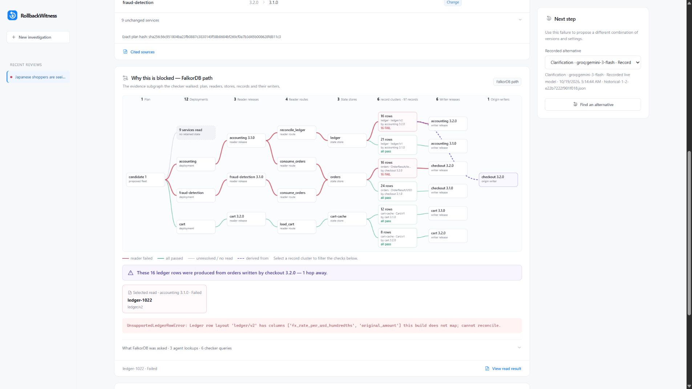
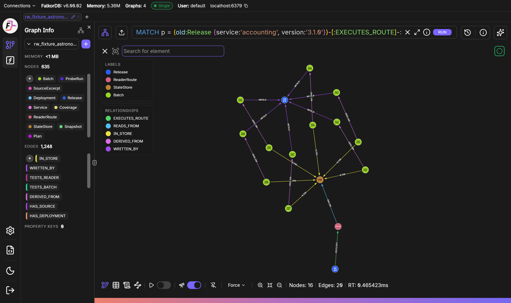
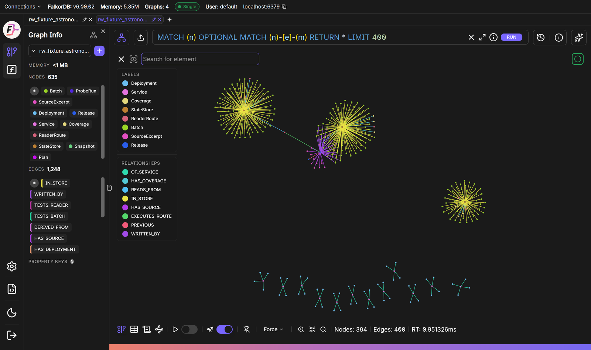
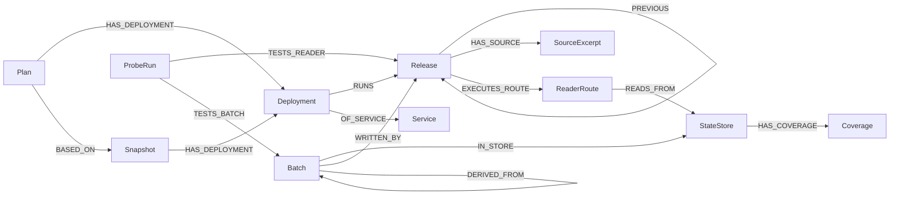
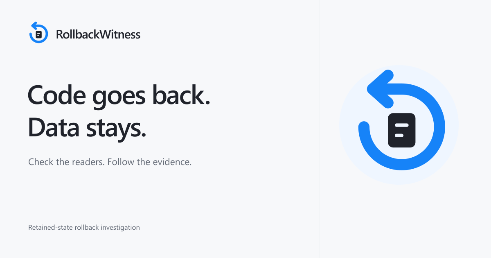

<h1 align="center">
  <picture>
    <source media="(prefers-color-scheme: dark)" srcset="src/rw/static/brand/wordmark-dark.svg">
    <source media="(prefers-color-scheme: light)" srcset="src/rw/static/brand/wordmark-light.svg">
    
  </picture>
</h1>

<p align="center"><strong>Rolling back code does not roll back the data it wrote.</strong></p>

<p align="center">
  A Graph Hacks 2026 project for the WeMakeDevs × FalkorDB “Context for AI Agents” hackathon.<br>
  <strong>Track: Agents That Act on Connected Data.</strong>
</p>

<p align="center">
  <a href="#falkordb-in-action">FalkorDB in action</a> &nbsp;·&nbsp;
  <a href="#quickstart">Quickstart</a> &nbsp;·&nbsp;
  <a href="#how-it-works">How it works</a> &nbsp;·&nbsp;
  <a href="#results">Results</a> &nbsp;·&nbsp;
  <a href="docs/demo/DEMO_SCRIPT.md">Demo walkthrough</a> &nbsp;·&nbsp;
  <a href="docs/GRAPH_QUERIES.md">Graph queries</a> &nbsp;·&nbsp;
  <a href="docs/STATUS.md">Current status</a>
</p>

---

When a release goes wrong, the usual fix is to roll back to an older version. The code goes back; the records the newer version already saved stay. If the older readers cannot parse those records, the rollback fails after it has been deployed, even though every service starts and every health check is green.

RollbackWitness checks this before anything changes. An on-call engineer describes the rollback in plain language. An agent turns it into an exact set of existing builds (or asks a clarifying question), FalkorDB works out which readers that fleet will run and which saved records they will meet, and a checker runs those readers on the stored bytes. The result is one of three verdicts:

- **BLOCKED**: at least one reader cannot read a saved record. The verdict includes the failing record, the reader's error and the graph path that connects them.
- **NEEDS_EVIDENCE**: no failure was found, but something required to decide is missing (store coverage, a record's writer or format, a reader route, a receipt). Missing evidence is listed and is never treated as a pass.
- **BOUNDED_PASS**: every reader × record check derived for the plan has a passing receipt. This covers byte/shape readability of the modeled records, not production safety.

A person confirms the scope before checks run, and only a `BOUNDED_PASS` can be approved, for a local simulation. Nothing is deployed. The agent and the MCP tools cannot approve.

<p align="center">
  
  <br>
  <sub>Investigation workspace · synthetic Astronomy Incident fixture</sub>
</p>

## The thirty-second story

The demo fixture is a synthetic twelve-service shop modeled on the OpenTelemetry Astronomy Shop. Since 3.2.0, checkout saves orders in local currencies, and accounting books them as `ledger/v2` rows.

1. The engineer asks: *"Japanese shoppers are seeing wrong totals since 3.2.0. Roll back accounting and fraud-detection to 3.1.0. Leave checkout alone."* The agent proposes exactly that and cites the release notes it used.
2. Every proposed build starts **GREEN**. The checker derives 137 reader × record checks from the graph and runs them: 48 **FAIL**. The 3.1.0 readers cannot read the non-USD orders or the `ledger/v2` rows. Disposition: **BLOCKED**.
3. **FalkorDB shows why:** the 16 failing ledger rows were derived from orders written by checkout 3.2.0, the service the engineer asked to leave alone: `ledger/v2 row -DERIVED_FROM-> order -WRITTEN_BY-> checkout 3.2.0`.
4. Asked for an alternative, the agent asks before touching checkout. With permission, it keeps every service on 3.2.0 and turns off checkout's `localCurrencyCheckout` flag. Rechecked from scratch: **BOUNDED_PASS**, 137/137.
5. A person approves the local simulation. Applying the same approval twice changes nothing the second time.

## FalkorDB in action

FalkorDB is not just where the data sits. It decides what gets checked, and the agent works through it:

- **The agent's tools are graph queries.** The agent sees the fleet, release history, who reads each store and record lineage only through fixed, parameterized Cypher queries. It never writes Cypher itself.
- **One multi-hop query decides the checks.** `Plan → Deployment → Release → ReaderRoute → StateStore ← Batch → writer Release` returns every reader × record pair the plan will meet: 137 for the incident plan. A check means running one release's real decode function on one saved record's bytes.
- **A lineage traversal finds the hidden connection.** A variable-length `DERIVED_FROM*` walk traces the failing ledger rows to orders written by checkout 3.2.0. That fact goes to the agent, which then proposes turning off checkout's flag instead of rolling back the readers.
- **Every verdict has a graph path.** A BLOCKED result shows the exact path from the plan to the failing record and its writer, and the console shows the Cypher that ran.
- **Removing relationships removes the capability.** Delete the reader, store and record links while keeping every record, and no checks can be derived, so the verdict is `NEEDS_EVIDENCE`, never a pass. Delete only `DERIVED_FROM`, and the 48 failures are still found but none of them can be traced to an origin ([results](docs/results/RESULTS.md)).

The same graph in FalkorDB Browser, queried directly. This multi-hop query runs from the old accounting reader to the ledger rows it cannot read, then along `DERIVED_FROM` to the orders, and on to the checkout release that wrote them:

```cypher
MATCH p = (old:Release {service:'accounting', version:'3.1.0'})-[:EXECUTES_ROUTE]->(:ReaderRoute)
          -[:READS_FROM]->(:StateStore {id:'store:ledger'})
          <-[:IN_STORE]-(row:Batch {snapshot_id:'snapshot:snap-001', format_id:'ledger/v2'})
          -[:DERIVED_FROM]->(:Batch)-[:WRITTEN_BY]->(:Release {service:'checkout', version:'3.2.0'})
RETURN p LIMIT 6
```

<p align="center">
  
  <br>
  <sub>FalkorDB 6.0.2 Browser · graph <code>rw_fixture_astronomy-incident</code> · lineage query result (16 nodes, 20 edges)</sub>
</p>

<p align="center">
  
  <br>
  <sub>The whole incident graph: 635 nodes and 1,248 edges (releases, routes, stores, retained records, plans and probe receipts)</sub>
</p>

## How it works

| Part | Role |
|---|---|
| Grounding agent (`src/rw/grounding.py`) | A bounded tool loop (at most 8 model turns) over fixed, read-only graph tools. It proposes a fleet of existing release artifacts or asks a clarifying question, and must quote the release notes or code it relies on. The model is configurable (Groq, Gemini or any OpenAI-compatible endpoint; see [provider setup](docs/QUICKSTART.md#6-live-grounding-optional)). It never sees Cypher, probe internals or approval. |
| FalkorDB (`src/rw/graph.py`) | Holds releases, reader routes, stores, retained records and their lineage, snapshots, plans and receipts. All queries are fixed and parameterized with row caps. The multi-hop obligation query decides what gets checked and supplies the evidence path. |
| Trusted checker (`src/rw/verification.py`) | Cross-checks graph results against independently parsed release files and snapshot manifests, so a missing edge, conflicting record or truncated result becomes a named gap instead of disappearing. Computes the disposition: any failure blocks; any gap means `NEEDS_EVIDENCE`. |
| Probes (`src/rw/probes.py`) | Runs each release's allowlisted fixture reader on retained bytes in a bounded subprocess. Each receipt is bound to the exact obligation: plan, snapshot, release, codec, route, record, payload, probe spec and environment. |
| Approval & simulation (`src/rw/simulation.py`, `src/rw/api.py`) | Human approval only for `BOUNDED_PASS`. Evidence is re-verified before approval and before simulation, and a SQLite ledger applies each approval once. |
| UI (`src/rw/static/`) | Investigation workspace: cited proposal, scope confirmation, startup vs saved-data verdict, interactive evidence graph, receipt inspector, candidate comparison and human approval. Plain browser modules, no build step. See [docs/UI.md](docs/UI.md). |
| MCP server (`src/rw/mcp_server.py`) | Lets Claude Code or another MCP host start and follow investigations. See [Local MCP tools](#local-mcp-tools). |

## Demo

**Incident demo** (`fixtures/astronomy-incident`): twelve services and 97 retained records across three stores (40 orders, 37 ledger rows, 20 saved carts); the story above. Turning off checkout's local-currency flag stops new local-currency writes; it does not repair stored data or prove the totals correct.

```sh
.venv/bin/python scripts/serve_demo.py     # Windows: .venv\Scripts\python.exe scripts\serve_demo.py
```

Open `http://127.0.0.1:8000`. **No model key is needed for the demo**: open **Demo setup**, choose **Saved replay** and pick the saved conversations in `artifacts/demo/replays/` (initial proposal, clarification, answered proposal). Replays reuse a recorded agent conversation; the graph queries and reader checks run fresh, and the workspace stays labeled **Replay · not live**. With a configured model key, the same request runs live. The [demo walkthrough](docs/demo/DEMO_SCRIPT.md) has the narration and the exact inputs.

**Astronomy Shop comparison** (`fixtures/astronomy-shop`): the original four-service version of the same idea, used for the published comparisons. checkout 3.2.0 writes non-USD orders that accounting and fraud-detection 3.1.0 cannot read. Rolling all three back to 3.1.0 is **BLOCKED** (32 of 80 checks fail); rolling back only checkout gives **BOUNDED_PASS** (80/80). Commands are in the [Quickstart](#quickstart).

## Results

Small samples on synthetic fixtures. Where a model is compared, both sides use the same model; the checker, relationship-removal and SQL rows have no model on the graph side. Treat these as indications, not benchmarks. Method, configuration and raw files: [docs/results/RESULTS.md](docs/results/RESULTS.md).

| Comparison | RollbackWitness (graph + checker) | Control |
|---|---|---|
| **Remove the graph's relationships, keep every record** (incident fixture, no model) | Full graph: **BLOCKED**, 137 checks derived, 48 failures found, 16 failures traced to their origin | Without reader, store and record links: 0 checks derived, failures never found, verdict `NEEDS_EVIDENCE`, never a pass. Without `DERIVED_FROM`: the 48 failures are still found, but none can be traced to an origin |
| Same model with and without the graph, same probe tool (shop fixture) | 13 correct and evidence-backed + 1 clarifying question (14 runs); 0 unsupported "safe" claims | Plain-text control: 9/13 correct; 3 "safe" claims without probing a required reader; 1 wrong "safe" |
| Deterministic checker vs one model call with every fixture file as text (Astronomy Shop, 6 designed cases; model 3 runs each) | Checker: 6/6 designed cases | Model: 15/18; on an incomplete order inventory it answered "safe" 2 of 3 times |
| Request grounding (5 cases × 3 runs) | 13/15 matched the expected proposal or clarification | — |
| SQL joins over the same raw facts (8 hand-derived cases) | 8/8 | 8/8. A tie: the graph is not the only way to compute obligations; it drives what the agent checks and supplies the evidence path |

<details>
<summary><strong>Graph data model and Cypher reference</strong></summary>

## Graph data model

FalkorDB 6.0.2, one graph per fixture. Everything is imported from the fixture files by `graph.reset_and_import`; plans and probe receipts are written back during an investigation.



| Node | What it is | Key properties |
|---|---|---|
| `Service` | A service in the fleet | `id`, `name` |
| `Release` | One existing build artifact | `id` (artifact hash), `service`, `version`, `built_at`, `codec_hash`, `codec_path`, `bundle_id`, declared flags |
| `SourceExcerpt` | A changelog bullet or a top-level code `def` of a release | `kind`, `path`, `line_start`/`line_end`, `text`, `content_hash` |
| `Snapshot` | The captured state of an environment (what runs, what is stored) | `id`, manifest hash |
| `Deployment` | "Service X runs release Y with flags F", in a snapshot or a candidate plan | `service`, `version`, `flags_json` |
| `Plan` | A candidate rollback fleet proposed by the agent or an operator | `id`, plan hash, request, origin |
| `ReaderRoute` | A code path in a release that reads retained state | `name`, `entry`, `read_domain`, `route_contract_hash` |
| `StateStore` | A store holding data that survives a rollback (for example `orders`) | `id`, `kind` |
| `Coverage` | Whether the snapshot's inventory of a store is complete | `status` (`COMPLETE` / partial), `inventory_id_hash` |
| `Batch` | A retained record in a store, with its bytes | `record_id`, `format_id`, `payload_hash`, `payload_path`, `snapshot_id` |
| `ProbeRun` | A receipt from running a reader on a record's stored bytes | `result` (PASS/FAIL/…), `obligation_hash`, `plan_hash`, `receipt_json` |

`DERIVED_FROM` records lineage between retained records (for example, a ledger row booked from an order). It explains where incompatible data came from; compatibility itself is decided only by probe receipts.

The question the graph answers: **for this candidate plan, which readers will execute, which retained records can they meet, and who wrote those records?** That is the path `Plan → Deployment → Release → ReaderRoute → StateStore ← Batch → writer Release`.

## Cypher the product depends on

All queries are fixed and parameterized in `src/rw/graph.py`; the model never writes Cypher. Each read is capped at 200 rows (`LIMIT $limit` fetches one extra row), and a capped result is reported as truncated, never as complete.

**1. Obligations: what must be checked for this plan** (`obligation_paths`). Each row is one reader × retained-record obligation. The probe runner executes exactly these rows, and a failing row is the evidence path shown for a BLOCKED verdict.

```cypher
MATCH (p:Plan {id: $plan_id})-[:HAS_DEPLOYMENT]->(d:Deployment)-[:RUNS]->(r:Release)
      -[:EXECUTES_ROUTE]->(rt:ReaderRoute)-[:READS_FROM]->(s:StateStore)
      <-[:IN_STORE]-(b:Batch {snapshot_id: $snapshot_id})
OPTIONAL MATCH (b)-[:WRITTEN_BY]->(w:Release)
RETURN p.id AS plan_id, d.id AS deployment_id, r.service AS service, r.id AS release_id,
       r.codec_hash AS codec_hash, rt.id AS route_id, s.id AS store_id, b.id AS batch_id,
       b.record_id AS record_id, b.payload_hash AS payload_hash, b.format_id AS format_id,
       w.id AS writer_release_id, w.version AS writer_version
ORDER BY d.id, b.record_id
LIMIT $limit
```

**2. Reader routes of a plan** (`plan_reader_routes`). `OPTIONAL MATCH` keeps a deployment with a missing release, route or store visible, so the checker reports a gap (`NEEDS_EVIDENCE`) instead of silently checking less.

```cypher
MATCH (p:Plan {id: $plan_id})-[:HAS_DEPLOYMENT]->(d:Deployment)
OPTIONAL MATCH (d)-[:RUNS]->(r:Release)
OPTIONAL MATCH (r)-[:EXECUTES_ROUTE]->(rt:ReaderRoute)
OPTIONAL MATCH (rt)-[:READS_FROM]->(st:StateStore)
RETURN d.service AS service, r.id AS release_id, r.codec_path AS codec_path,
       rt.id AS route_id, rt.entry AS entry, rt.read_domain AS read_domain, st.id AS store_id
ORDER BY d.service, rt.name
LIMIT $limit
```

**3. Release history with source: the agent's grounding tool** (`release_history`). Walks the `PREVIOUS` chain from the running build and returns each release's changelog and code excerpts, which the agent must quote verbatim to justify a proposal.

```cypher
MATCH (s:Snapshot {id: $snapshot_id})-[:HAS_DEPLOYMENT]->(d:Deployment {service: $service})-[:RUNS]->(r:Release)
MATCH path = (r)-[:PREVIOUS*0..10]->(p:Release)
WITH p, length(path) AS depth WHERE depth <= $max_depth
OPTIONAL MATCH (p)-[:HAS_SOURCE]->(e:SourceExcerpt)
WITH p, depth, e ORDER BY depth, e.path, e.line_start
RETURN p.id AS release_id, p.version AS version, depth,
       collect({excerpt_id: e.id, kind: e.kind, path: e.path, text: e.text}) AS excerpts
ORDER BY depth
LIMIT $limit
```

**4. Who reads a store** (`store_readers`): another agent tool, used to find every release affected by data in a store.

```cypher
MATCH (st:StateStore {id: $store_id})<-[:READS_FROM]-(rt:ReaderRoute)<-[:EXECUTES_ROUTE]-(r:Release)
OPTIONAL MATCH (d:Deployment)-[:RUNS]->(r)
OPTIONAL MATCH (sn:Snapshot)-[:HAS_DEPLOYMENT]->(d)
RETURN r.id AS release_id, r.service AS service, r.version AS version, rt.id AS route_id,
       rt.entry AS entry, collect(DISTINCT sn.id) AS currently_deployed_in
ORDER BY r.id, rt.id
LIMIT $limit
```

Store inventory (`store_inventory`), record origins (`record_origins`, which follows `DERIVED_FROM`) and receipt read-back (`receipts_by_id`) complete the loop. Probe receipts are written with `MERGE (pr:ProbeRun …)-[:TESTS_READER]->(release)` and `-[:TESTS_BATCH]->(batch)`. Queries 3–4 are shown with abbreviated `RETURN` lists; the source has the full column set.

The [query and algorithm reference](docs/GRAPH_QUERIES.md) documents every query for both workflows, including the repository-evidence queries, completeness and receipt validation, and a runnable read-only example.

</details>

## Quickstart

Prerequisites: Git, Docker with Compose v2, and [`uv`](https://docs.astral.sh/uv/). The setup script creates `.venv` with Python 3.12 and pinned dependencies. Run every command from the repository root; no frontend build is needed.

```sh
git clone https://github.com/Ep1cGaimer/FalkorDB_agent.git rollbackwitness
cd rollbackwitness
docker compose up -d --wait            # FalkorDB 6.0.2 on 127.0.0.1:6379
sh scripts/setup.sh                    # Windows: powershell -ExecutionPolicy Bypass -File scripts\setup.ps1
.venv/bin/python scripts/smoke.py      # end-to-end check with real graph queries and reader probes; no model key
.venv/bin/python scripts/serve_demo.py # incident demo on http://127.0.0.1:8000
```

On Windows, use `.venv\Scripts\python.exe` in place of `.venv/bin/python`. Stop the server with Ctrl+C and the database with `docker compose stop`.

**Without a model key**, everything except live grounding works: the smoke test, saved replays, and checks of an operator-specified fleet:

```sh
# The incident rollback as requested, no agent involved: BLOCKED, with the evidence path
RW_FIXTURE=astronomy-incident .venv/bin/python scripts/investigate.py --fleet accounting=3.1.0 --fleet fraud-detection=3.1.0 --confirm-as you

# Astronomy Shop: all three back to 3.1.0 (BLOCKED), then only checkout (BOUNDED_PASS)
RW_FIXTURE=astronomy-shop .venv/bin/python scripts/investigate.py --fleet checkout=3.1.0 --fleet accounting=3.1.0 --fleet fraud-detection=3.1.0 --confirm-as you
RW_FIXTURE=astronomy-shop .venv/bin/python scripts/investigate.py --fleet checkout=3.1.0 --confirm-as you
```

In PowerShell, set the fixture first with `$env:RW_FIXTURE = "astronomy-incident"`.

**Live grounding** needs a model provider. Copy `.env.example` to `.env` (git-ignored), add your key, and choose the model chain as described in [provider setup](docs/QUICKSTART.md#6-live-grounding-optional). Then ask in plain language, in the UI or from the CLI:

```sh
.venv/bin/python scripts/investigate.py "Undo the basket rollout, but keep the receipt correction." --confirm-as you
```

**Tests:** `.venv/bin/python -m pytest -q -m "not live"` runs the offline suite against the local FalkorDB; `node --test tests/js/` runs the UI unit tests. `scripts/prepare_demo.py` re-validates the saved demo replays with fresh graph and reader checks. Full instructions: [docs/QUICKSTART.md](docs/QUICKSTART.md).

**Second workflow.** A separate, deterministic repository-evidence workflow indexes real Git history into FalkorDB and answers dependency and fix-presence questions with verifiable source citations. Setup and graph model: [docs/repo/DEMO.md](docs/repo/DEMO.md).

## Local MCP tools

Install the optional MCP bridge with `sh scripts/setup.sh --mcp` (PowerShell: `scripts\setup.ps1 -Mcp`). Start the HTTP API (`scripts/serve_demo.py` or `scripts/serve.py`), then register `scripts/serve_mcp.py` with your MCP host using absolute interpreter and script paths. The server exposes eight tools: start, list and read investigations, list saved replays, answer a clarification, request an alternative, read a short verdict, and query the repository-evidence graph. Scope confirmation, approval and local simulation stay with a person in the console, through the review link each tool returns. See [docs/MCP.md](docs/MCP.md) for host configuration, input limits and retry behavior.

## Evidence and limits

- **Independent oracle:** 8 hand-derived cases in `evals/expected/`; the full pipeline on a real FalkorDB matches all 8 (disposition, exact obligations, probe results and gaps).
- **Synthetic data:** all rollback fixtures are synthetic. The Astronomy fixtures are modeled on OpenTelemetry Demo 3.1.0 (Apache-2.0); their 3.2.0 releases were written for this project.
- **What a pass means:** `BOUNDED_PASS` covers byte/shape readability of the modeled records only. Readers are reviewed fixture models of each release's decode step, not upstream binaries, and the probe harness contains failures rather than sandboxing untrusted code.
- **Local only:** approval runs a local simulation; nothing is deployed. The HTTP API is unauthenticated and meant for loopback, so the approver name is a local label, not a verified identity.
- **Known gap:** vague time references (for example "from last week") are sometimes guessed instead of clarified. Open questions are tracked in [GitHub Issues](https://github.com/Ep1cGaimer/FalkorDB_agent/issues) and [docs/STATUS.md](docs/STATUS.md).

## Repository layout

```text
src/rw/                      product: contracts, graph, verification, probes, grounding, pipeline, API, simulation, MCP server, static UI
src/rw/repo/                 second workflow: Git-history indexing and deterministic evidence queries
fixtures/astronomy-incident/ incident demo fixture: twelve services, three stores, order-to-ledger lineage
fixtures/astronomy-shop/     four-service Astronomy Shop fixture used for the published comparisons
fixtures/shop/               default fixture for tests and controls: cart and checkout, saved carts, probe harness
artifacts/demo/replays/      saved agent conversations for the incident demo
evals/                       hand-derived expected outcomes, SQL and LLM controls, relationship-removal experiment, grounding evals
scripts/                     setup, smoke test, CLI, demo and console servers, MCP bridge, fixture and brand builders
tests/                       unit, integration (real FalkorDB), UI and acceptance tests
docs/                        quickstart, status, project guide, architecture, contracts, graph queries, UI, MCP, results, demo
```

<details>
<summary><strong>Visual identity and assets</strong></summary>



[SVG and PNG assets](src/rw/static/brand/) · [Usage guide](src/rw/static/brand/README.md) · [Download the kit](src/rw/static/brand/rollbackwitness-brand-kit.zip)

</details>
