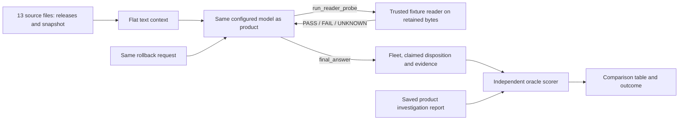

# Issue #3: initial analysis and solution options

Study date: 2026-10-16. Source checkout: `771ce3814e7ad8bb6c5902e4ac9de83a711abbee` on `main`.

Issue: [Live run of the equal-information LLM control](https://github.com/Ep1cGaimer/FalkorDB_agent/issues/3), read through the authenticated GitHub API, including its comment. It was open when inspected. The issue mentions `build/slice-2`; this analysis uses the checked-out `main`, which contains the control implementation.

**Follow-up:** live attempts now also show provider tool-call errors, so the historical quota diagnosis is incomplete. See [ISSUE_3_LIVE_RESULTS.md](ISSUE_3_LIVE_RESULTS.md) for the recorded outcomes and remaining acceptance work.

**Implementation authorization:** the user subsequently authorized focused code fixes. The earlier environment-only constraint below is historical. See [ISSUE_3_FIX_REPORT.md](ISSUE_3_FIX_REPORT.md) for the changes, reasons, current configuration and verification.

Unless explicitly marked as a follow-up, the findings and recommendations below describe the base checkout **before those fixes**. Statements about missing `.env` loading, deferred changes and old live-test behavior belong to that initial snapshot.

## Maintainer clarification: environment-only configuration

The maintainer permits using another model/provider through environment variables, requires OpenAI API compatibility, and does not authorize application code changes. The user relayed this clarification after the initial study.

The current checkout supports `RW_GROUNDING_MODEL` and `GROQ_API_KEY`, but `GROQ_API_URL` is a hardcoded Python constant in `src/rw/grounding.py`. It does not read `OPENAI_BASE_URL` or another endpoint environment variable. Setting those variables would not redirect requests to another provider, even if that provider implements OpenAI-compatible Chat Completions and tool calls.

Under this restriction, the directly supported path is to use a suitable Groq model and account capacity through the existing variables, with the same model pinned for both workflows. Another host requires an existing endpoint override on a different revision, or a separately authorized configuration-support change. Gemini uses the existing native Gemini adapter and does not satisfy an OpenAI-compatible endpoint requirement through that adapter.

The code fixes discussed below remain deferred proposals. Options A and B fit the environment-only constraint; the other options require revisiting the agreed protocol or implementation.

Follow-up configuration: the user supplied a Groq credential, saved locally in the git-ignored `.env` with file mode `0600`. `RW_GROUNDING_MODEL` is pinned to `groq:openai/gpt-oss-120b` for both workflows. An authenticated Groq models-list request returned HTTP 200 and included that model. This verifies authentication and model visibility; it does not establish remaining inference quota or complete any live control evaluation. No application code was changed.

## What needs to be fixed?

The project has a flat-context LLM control, but lacks the live evidence needed for its product comparison. The issue requires:

1. The control's live test passes at least three times.
2. `evals/score_controls.py` output is recorded for control versus product using the same model.
3. A tie or control win is reported honestly.

This is primarily an **evaluation completion and reproducibility problem**. It does not require redesigning the compatibility checker. The exact current quota available to your team remains unknown; this study did not send model requests.

With the maintainer's environment-only constraint, my recommendation is to keep the existing control intact, pin one supported Groq model for both sides, and run a paced paired evaluation using capacity that can accept the complete conversation. Export configuration in the process environment to avoid relying on the CLI's missing `.env` load. Try existing sufficient capacity first; a higher-limit tier is an option for the team's cost decision if free capacity cannot fit it.

## How the control works



[`llm_control.py`](../evals/llm_control.py) reads each release's `release.json`, `CHANGELOG.md` and `codec.py`, plus the selected snapshot manifest. Payload bytes are available through probes rather than being pasted into the prompt.

The control shares the product's provider transports, temperature 0 and eight-model-turn cap. At the original study it used `final_answer`; the current version-4 protocol uses `submit_assessment`. The model supplies its own disposition. The scorer compares that claim and observed probe coverage with independently authored expectations.

## Findings grounded in the code

### 1. The 17 KB observation is reproducible, but is not a token count

Rendering the initial Groq-style control request locally produced:

| Measurement | Result |
|---|---:|
| Source files included | 13 |
| Flat source context | 10,685 characters |
| System prompt | 3,561 characters |
| Serialized initial request, including tool declarations | 17,335 characters |
| Maximum model turns | 8 |

The serialized request count uses Python's `json.dumps(body)` before transport adds the model field. It is a useful size check, not the exact HTTP wire byte count or provider token accounting.

Each later call sends conversation history again, including previous tool results. Three evaluations can therefore use much more than three initial prompts. Fallback restarts the conversation and adds more usage.

The source measurements are current to this checkout. The daily exhaustion and Qwen request-size failures in [STATUS.md](STATUS.md) are earlier observations, not fresh quota probes.

Groq distinguishes per-minute and per-day limits, including separate input/output limits for some accounts. Its documentation says the account Limits page is authoritative for the organization's exact limits. Do not convert “17 KB” into “17k tokens” or treat a rate allowance as the model's context-window size. [Official rate-limit documentation](https://console.groq.com/docs/rate-limits)

### 2. The standalone control CLI does not load `.env`

`scripts/investigate.py:main`, `scripts/serve.py` and the live control test call `config.load_env`. `evals/llm_control.py:main` does not.

Consequently, a key stored only in the project's `.env` can work through the product CLI and pytest but fail through the documented standalone control command. The same mismatch applies to `RW_GROUNDING_MODEL` stored only in `.env`.

A local diagnostic replaced `config.load_env` with a call recorder and replaced `run_control` with a non-network stub. Calling `main([])` made **zero loader calls**, with **zero provider requests**. This confirms the missing entrypoint call; it does not reproduce the historical provider quota error.

**Proposed small fix:** load `.env` before `configured_models()` in the control CLI, following the other entrypoints. Add a focused test that uses a temporary file and checks loading order without contacting a provider. Preserve the existing rule that exported shell values take precedence.

### 3. The same fallback chain does not guarantee the same model

The default chain is:

```text
groq:openai/gpt-oss-120b,groq:qwen/qwen3.8-27b
```

Both `grounding.ground` and `llm_control.run_control` restart the whole conversation on a new chain entry after a transport failure. A shorter product run could finish on the first model while the larger control falls back to the second.

**Proposed evaluation configuration:** set `RW_GROUNDING_MODEL` to exactly one `provider:model` for both sides. Check the actual transcript model too. If it fails, record the failure and retry under an explicit budget rather than substituting a different model into that pair.

Switching both sides to a supported Gemini model is possible with the existing adapters. Choose an available model with sufficient capacity and access; adding a second provider only for the control would break the requested same-model comparison.

### 4. The live test has a Groq-only key gate

`tests/test_llm_control.py:test_live_control_runs_once` skips when `GROQ_API_KEY` is missing, even if `RW_GROUNDING_MODEL` is configured to use Gemini and `GEMINI_API_KEY` is available.

**Proposed small fix:** check credentials for the configured providers rather than always requiring Groq. A skipped test does not count as one of the three successful live runs.

This issue matters when selecting the alternate-provider option; it does not explain a Groq quota failure when a valid Groq key exists.

### 5. Passing pytest does not automatically create the comparison dataset

The live test saves its transcript under pytest's `tmp_path`. The scorer normally scans `artifacts/controls/` and `artifacts/reports/`. Running pytest three times and then invoking the scorer can therefore leave it with no relevant saved control runs.

Also, the current test establishes a usable answer and a few minimum checks. It does not require every obligation to have a successful applicable probe or require `validation_errors` to be empty. A green live test is not a complete evidence-quality assessment.

**Proposed evaluation tooling:** preserve each live-test transcript in a dedicated run directory, or copy it from the printed path before pytest retention removes it. Run the independent scorer on exactly those files and matching product reports. Record validation errors and UNKNOWN probes alongside its output.

### 6. Retry handling already addresses some failures

`grounding._retrying_post` retries transient statuses, including ordinary HTTP 429 responses. It treats HTTP 413 as non-retryable, and rejects 429 messages identifying daily exhaustion or an oversized request. Both workflows reuse this implementation.

**Implication:** simply adding more retries is unlikely to fix the recorded blocker. Pacing can help when requests fit individually but exceed a shared time window. Waiting cannot make an individually oversized request fit. Daily exhaustion needs available daily capacity or another agreed model for both sides. [Groq error definitions](https://console.groq.com/docs/errors), [rate limits](https://console.groq.com/docs/rate-limits).

## Possible solutions and tradeoffs

| Option | What changes | Advantage | Limitation |
|---|---|---|---|
| A. Pace runs on existing capacity | Run sequentially with one model; honor reset windows and reserve capacity for both sides. | Keeps the current experiment and avoids a billing change. | Works only if each full conversation request fits and daily allowance remains. |
| B. Use higher-limit capacity for the same model | Team selects a tier/account allowance that can fit the measured workload. | Least change to prompts, model identity and implementation. | Requires a cost decision; verify actual limits first. |
| C. Use another supported provider/model for both sides | Pin the same available Gemini model for product and control; fix the live test's key gate. | Reuses existing adapters and avoids dependence on one provider's quota. | Results apply to that model; capability, limits and network behavior need verification. |
| D. Reduce prompt overhead without dropping facts | Compact the presentation, retain provenance and use identical revised material throughout that evaluation. | May fit a restrictive input budget. | Still requires careful token measurement; changes the current verbatim-context protocol. Record it as a revision. |
| E. Build a lazy file-reading flat control | Give the model a neutral file listing and bounded read access instead of all content upfront. | Can reduce repeated context. | A larger implementation and a different retrieval experiment; needs an agreed protocol and may still grow past limits. |

Within the clarified scope, I would choose **A if the measured budget fits; otherwise B**. Preserve evidence manually and leave application/test code unchanged. C, D and E are outside the current restriction; the code fixes identified above are deferred.

Reducing from three runs to one would not meet this issue's acceptance criterion. Removing the newer record, withholding source files or using replay as live evidence would change the experiment rather than complete it.

## Deferred implementation proposals

These are proposed changes, not implemented fixes:

1. **Entrypoint consistency:** add `config.load_env()` to the control CLI before model selection.
2. **Provider-aware live gating:** check the configured chain's credentials and report skips explicitly.
3. **Paired-run metadata:** record source commit, fixture hashes, request, snapshot, actual model, prompts/settings and timestamps. Keep token estimates separate from provider-reported usage.
4. **Capacity handling:** budget for growing history, successful output, transient retries and both sides of all three pairs. Use actual account limits; capture safe usage/reset metadata where available.
5. **Evidence preservation:** save three successful live-test transcripts and the corresponding product reports in dedicated directories. Keep failed attempts and their costs visible too.
6. **Independent scoring:** score that dataset only, review validation errors and probe results, and commit a concise report with a tie/control-win/product-ahead result as observed.

These proposals would require separate authorization under the maintainer's clarification. A manual, documented paired run with exported variables can exercise the existing Groq path without these edits.

Suggested regression checks should cover `.env` loading order, Gemini-only credentials, a genuine three-success count, same-model pairing and saved-artifact discovery. Existing fallback/retry tests already cover basic transport behavior; preserve them.

## Commands available today

These are instructions for after the team chooses model capacity; **they were not executed as live evaluations in this study**.

Use one model. This is the repository's first default, not a promise that your account currently has capacity:

```bash
export RW_GROUNDING_MODEL='groq:openai/gpt-oss-120b'
```

A workaround for the current CLI's missing `.env` load is to load configuration before its entrypoint:

```bash
PYTHONPATH=src .venv/bin/python -c \
  "from rw.config import load_env; import runpy; load_env(); runpy.run_path('evals/llm_control.py', run_name='__main__')" \
  --out artifacts/issue-3/controls
```

This saves a live control transcript when a run finishes, but the command alone does not fulfill the separate requirement to pass the live test three times. It is useful for a capacity smoke check; avoid duplicating paid calls unnecessarily.

The existing live test is:

```bash
.venv/bin/python -m pytest -q -s -m live \
  tests/test_llm_control.py::test_live_control_runs_once
```

Repeat under the agreed budget until three runs actually pass; preserve each printed transcript path. A skip, provider error or replay does not count. The test can itself make two control attempts, so track attempts separately from successful tests.

For the product side, use the same request, snapshot and single model. `--no-alternative` keeps this example to the first proposed candidate:

```bash
.venv/bin/python scripts/investigate.py \
  "Undo the basket rollout, but keep the receipt correction." \
  --confirm-as reviewer --no-alternative
```

Copy the saved product reports for the selected runs into `artifacts/issue-3/reports/`. Product clarifications or rejected proposals should remain visible; do not silently replace them with operator-specified fleets. If you introduce an answer round, document the extra information supplied and its effect on comparability.

After collecting the actual runs:

```bash
mkdir -p evals/results
.venv/bin/python evals/score_controls.py \
  --controls artifacts/issue-3/controls \
  --reports artifacts/issue-3/reports \
  --json evals/results/issue-3-comparison.json \
  > evals/results/issue-3-comparison.md
```

Both `artifacts/` and `evals/results/` are git-ignored. Preserve a reviewed report in a tracked documentation file when completing the issue. Do not assume generated files will appear in a commit automatically.

The scorer aggregates supplied files; it does not enforce same-model pairs for you. Use isolated directories, inspect model labels and compare equal run counts. Its “false BOUNDED_PASS” column means a contradiction with the oracle's expected disposition; separately inspect incomplete probe recall, UNKNOWN results and validation errors even when that column says no.

## Study evidence

Only documentation was edited for this analysis. No application fix, live provider evaluation, commit, push or issue update was performed.

| Check | Observed result |
|---|---|
| Authenticated GitHub issue and comment read | Issue #3 open; three live-test passes and same-model scoring required. |
| Initial control rendering | 13 context files; 17,335 serialized request characters. No provider call. |
| Control entrypoint diagnostic with stubbed runner | `config.load_env` called zero times. No provider call. |
| Focused tests without graph-backed cases | 135 passed, 4 deselected. |
| `.venv/bin/python -m pytest -q -m "not live"` | 295 passed, 3 deselected on the pinned FalkorDB server. |
| `.venv/bin/python scripts/smoke.py` | All eight PASS checkpoints, including blocked approval refusal, alternative pass, idempotent simulation and missing-evidence snapshots. |
| Documentation checks | Six Mermaid diagrams parsed successfully; all 32 relative file links resolve; `git diff --check` passed. |

An initial broader selection was run before the FalkorDB server was started: 170 passed, 2 failed and 16 setup errors. Those graph-backed failures were connection refusals. The narrowed 135-test run passed; the full suite was then rerun with the pinned server available. Do not report the setup failure as an application regression.

The project setup script installed dependencies into the local `.venv`. The pinned fixture container was started for verification and removed afterwards. The pre-existing untracked `uv.lock` was left untouched.

No current provider quota, model-quality comparison or live control score is claimed. The earlier live observations remain attributed to [STATUS.md](STATUS.md). The project overview and examples are in [PROJECT_GUIDE.md](PROJECT_GUIDE.md).
