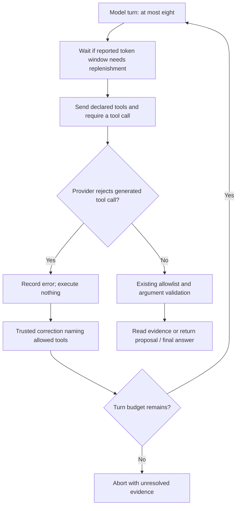

# Issue #3: changes, reasons and verification

The user authorized focused code changes after the initial environment-only attempts failed. This report supersedes that earlier implementation restriction. The [pre-fix live results](ISSUE_3_LIVE_RESULTS.md) remain historical evidence, not results for this patch.

Base commit: `771ce3814e7ad8bb6c5902e4ac9de83a711abbee`. Changes are local and uncommitted. All records and release artifacts are synthetic.

**Result:** issue #3's local acceptance is verified: three live control-test passes and three same-model product runs, with unchanged tested source. The [recorded comparison](ISSUE_3_COMPARISON.md) contains the exact scorer output and interpretation. This is local evidence; the GitHub issue remains untouched.

## What the investigation established

The original diagnosis contained two distinct problems:

1. **Protocol mismatch.** The application expects every model response to call a declared tool, but Groq requests used `tool_choice="auto"`. In a diagnostic conversation, the model ran four reader probes and then returned a plain JSON answer without a `final_answer` tool call. Earlier live tests also ended in HTTP 400 `tool_use_failed`, including attempts to call undeclared names `json` and `commentary`.
2. **Calls exceeded the currently available token window.** A captured initial request used 4,119 prompt tokens. Subsequent requests repeatedly received HTTP 429 against the 8,000-token-per-minute limit. Successful responses already included the remaining token allowance and reset duration, but the client discarded them and immediately sent another request.

These observations explain the changes below. They do not establish that every earlier HTTP 400 had the same exact generation path; older errors were truncated and did not preserve the complete response.

The captured baseline is under `artifacts/issue-3/diagnostics/`. The diagnostic loop recorded real HTTP responses and retained the original request behavior. It eventually stopped on a rate-limit refusal; it was not counted as a successful evaluation.

## Changes and why each was needed

| File / area | Change | Reason |
|---|---|---|
| [`src/rw/grounding.py`](../src/rw/grounding.py), `GroqProvider.body` | Require a tool call and disable parallel tool calls. | Matches the existing tool-only protocol and the current models' sequential tool support. A plain prose/JSON response should not be accepted as a terminal action. |
| Groq wire history | Serialize tool results as compact UTF-8 JSON and forward assistant content/tool calls without provider-only reasoning metadata. | Reduces avoidable input size while preserving decoded source values and exact tool-call IDs/arguments. |
| Grounding excerpt delivery | Replace repeated excerpt text with an ID/hash reference only after that exact text survived the output cap and reached an earlier model message. Keep full text internally for citation validation. | Prevents repeated retrieval from overflowing the input allowance without withholding unique evidence. Capped-away text and changed content hashes are sent in full on the next successful delivery. |
| `ToolCallRejected`, `_retrying_post`, `model_response` | Recognize only HTTP 400 `tool_use_failed`; record the rejected generation as data and give the model a trusted correction listing the declared tools. | A malformed generated call should be correctable without restarting the whole investigation. Rejected text is never executed or treated as a valid call. Authentication, quota and unrelated request errors retain their existing handling. |
| Product and control model loops | Use the same correction helper and count each rejection against the existing eight-turn cap. | Neither workflow gets unlimited retries or an extra hidden reasoning budget. Repeated rejection ends as an aborted/unresolved result. |
| Replay transport | Replay recorded rejected-generation events as rejections. | A replay must preserve correction turns and their budget cost, rather than silently skipping them. |
| Groq transport | Use reported token-window headers to pace later calls when the remaining allowance is below a conservative request estimate. | Avoid immediately issuing a request that is likely to be rate-limited. Missing headers remain unknown. The estimate schedules calls; it does not decide compatibility or claim an exact token count. |
| Groq generation settings | Set a completion-token cap and explicitly retain GPT-OSS's `medium` reasoning default, with environment overrides. | Bound generation without silently lowering the original reasoning setting. Both workflows use the same transport settings and record them. |
| Control terminal protocol | Rename `final_answer` to `submit_assessment` and explicitly require submitting through the tool API; remind the model to reuse prior probe results. | The pilot still treated completion as prose/JSON and repeated probes. The new name/instruction distinguishes submission from a plain final-channel answer, without telling the model which fleet or disposition to choose. |
| Grounding/control transcripts | Record generation settings, actual provider usage, safe rate-limit metadata and partial event history on provider failures. Product failures are stored in a separate `failures/` directory. | Makes capacity and retry behavior inspectable without saving authorization headers or API keys. Failures cannot be mistaken for replayable successful investigations. |
| [`evals/llm_control.py`](../evals/llm_control.py), CLI | Load `.env` before selecting models or reading credentials. | Previously the product CLI and live test loaded `.env`, but the standalone control CLI did not. |
| Control provider-failure handling | Save an aborted failure artifact even when all provider entries fail. | Failed trials must remain visible to the scorer. Partial event/probe history is explicitly marked unavailable rather than fabricated. |
| [`tests/test_llm_control.py`](../tests/test_llm_control.py), live test | Check credentials for the selected provider, require no validation errors, and run one conversation per test execution. | A Gemini configuration must not require a Groq key. A failed conversation must not disappear behind a silent full-conversation retry. |
| [`evals/score_controls.py`](../evals/score_controls.py) | Include rejected generations in product model-turn counts. | Keeps the reported budget consistent with the actual model loop. |
| [`evals/run_comparison.py`](../evals/run_comparison.py) | Run pinned-model test/product pairs, retain pytest/JUnit evidence and transcripts, check source hashes, and capture the existing scorer's output. | Makes the issue's acceptance work reproducible and prevents mixed-model, stale-source or missing-artifact comparisons. The runner uses disposable graphs and never approves or simulates a plan. |
| Regression tests | Cover rejection recovery and exhaustion, untrusted-text isolation, replay, credential selection, configuration validation, rate-header pacing, failure preservation, CLI loading order and turn counts. | Verifies the actual failure boundaries rather than merely checking that new fields exist. |



The graph/checker data contracts, retained bytes, expected outcomes, probe allowlists, receipt matching, deterministic dispositions and approval gates were not changed. No answers were inserted into either workflow's prompt. Provider-side tool validation remains enabled.

## Configuration

The existing ignored `.env` supplies the credential and pinned model. The local console was restarted with the comparison configuration below and returned HTTP 200. Do not commit the credential file.

```dotenv
RW_GROUNDING_MODEL=groq:qwen/qwen3.8-27b
RW_GROUNDING_MAX_COMPLETION_TOKENS=1000
```

The source default completion cap is 2048; the comparison and local console explicitly use 1000. For GPT-OSS models, `RW_GROUNDING_REASONING_EFFORT` defaults to `medium` and supports `low`, `medium` or `high`; it is not sent for Qwen. The temperature remains 0 and the maximum model-turn count remains eight.

Before restarting, the two earlier browser investigations were saved to `artifacts/issue-3/browser-state-before-restart-20261016T174444Z.json` (one `BLOCKED`, one `BOUNDED_PASS`). The new server starts with an empty in-memory investigation list. This backup is evidence, not an automatically restorable browser session.

This patch uses Groq's existing OpenAI-compatible Chat Completions endpoint. It does not add an arbitrary-provider endpoint override. See the official [tool-calling guide](https://console.groq.com/docs/tool-use/local-tool-calling), [API parameters](https://console.groq.com/docs/api-reference) and [rate-limit headers](https://console.groq.com/docs/rate-limits) for the provider contracts behind these choices.

## Verification

| Check | Result |
|---|---|
| Full non-live suite | **309 passed, 3 deselected** on the final context-compaction source. |
| Earlier full-suite attempt | 305 passed and one unrelated FalkorDB query timeout. The affected relational-control module then passed 17/17; the full rerun passed without changing graph code or server timeout. |
| Deterministic end-to-end smoke | Passed all eight checkpoints, including blocked approval, passing alternative, idempotent simulation and missing-evidence snapshots. |
| Three live control tests and same-model product comparison | **3/3 control tests passed**, zero skips; **3/3 product runs BOUNDED_PASS** on `groq:qwen/qwen3.8-27b`. Exact scorer: **product 3/3 vs control 0/3 oracle-consistent runs**, because control probe coverage was 3/4 versus product 4/4. Both had zero disposition-based false BOUNDED_PASS. |
| Source and context consistency | Runner source hashes unchanged; all 13 context-file hashes identical across controls and equal to the checkout. All six conversations' provider response model IDs match the pin. |
| Documentation | Seven Mermaid diagrams parsed successfully; new study/report links checked locally. |

An intermediate GPT-OSS 120B pilot with the initial transport patch and `low` reasoning still aborted after eight turns: it repeated probes and did not submit a terminal tool call. The corresponding product run correctly reported `BLOCKED`, with all four obligations checked. This failed pair is preserved at `artifacts/issue-3/comparison-20261016T170937113211Z/`; it is not counted as acceptance evidence. The final control protocol is version 4, and GPT-OSS reasoning defaults to its original `medium` setting.

The completed collection uses `groq:qwen/qwen3.8-27b` for both workflows, with `RW_GROUNDING_MAX_COMPLETION_TOKENS=1000` to fit the previously reported output allowance. The source default remains 2048, and the actual per-run settings are recorded rather than inferred. Evidence: `artifacts/issue-3/comparison-20261016T172909885914Z/`.

A pre-compaction version-4 pair at `artifacts/issue-3/comparison-20261016T171725456175Z/` produced a passing control test but a product HTTP 413 at the 7,000-input-token allowance. The control itself covered only 3/4 obligations and proposed the unchanged basket-enabled fleet. This prompted the lossless wire/context reductions described above. Neither this partial pair nor the earlier failed pilot is included in the final acceptance dataset.

A passing live control test establishes a usable terminal response, not perfect request interpretation or complete compatibility evidence. The independent scorer's obligation recall and the oracle's request-fit facts must be inspected separately; no model answer is rewritten to make the comparison look better.

In the final dataset, each control omitted one required probe and submitted `flags:` instead of `flags`, leaving the normalized basket flag on. Each product selected the flag-off fleet and checked all four obligations. The oracle still describes that fleet's behavioral rollback as partial because retained baskets and Checkout behavior remain. The [comparison interpretation](ISSUE_3_COMPARISON.md#how-to-read-the-result) explains why a passing execution test, an oracle-consistent readability result and full behavioral request satisfaction are different conclusions.

The final six conversations completed despite three corrected HTTP 400 tool-generation rejections and four recovered HTTP 429 responses. No HTTP 413 occurred. This demonstrates recovery on the tested workload, not unlimited quota or a guarantee for every model/request.

The runner hashes application, script, test and evaluation code plus JSON/HTML/JavaScript inputs. A change to those files during collection invalidates its completion flag. Each control transcript separately hashes all 13 supplied context files, including release changelogs; those hashes must also agree across the collected runs and with the final checkout. Documentation edits are outside the runner's source freeze.

## Test the local console

Open <http://127.0.0.1:8000> with `snap-001` selected. Provider pacing can make an investigation take several minutes; the browser's busy state is expected during those waits.

1. In **Live** mode, request `Roll cart back to 1.4, but keep checkout 2.1.` Inspect the proposed releases, enter your operator name, and click **Confirm scope for checking**. The expected result for that exact fleet is **BLOCKED**, with Cart 1.4 failing on `saved-cart-2002`.
2. Ask for an alternative, or start another request: `Keep cart 1.5, set basket_v2=false, and keep checkout 2.1.` Confirm the proposed scope. The expected result for that exact fleet is **BOUNDED_PASS**, with all four probes passing.
3. Inspect the fleet and receipts before approving a local simulation. The first simulation applies once; repeating it reports that it was already applied. This is separate from confirming scope.

These are model-assisted requests: a clarification or a different proposal must be reviewed, rather than assumed to match the expected fleet. For a repeatable check without a provider, use the operator-specified fleet commands in [the project guide](PROJECT_GUIDE.md#8-run-the-deterministic-example-on-linux-or-wsl).

## Reproduce the comparison

With FalkorDB running and the key configured locally:

```bash
docker compose up -d
.venv/bin/python -m pytest -q -m "not live"
.venv/bin/python scripts/smoke.py
RW_GROUNDING_MAX_COMPLETION_TOKENS=1000 \
  .venv/bin/python evals/run_comparison.py --runs 3 \
  --model groq:qwen/qwen3.8-27b
```

The runner prints its unique output directory under `artifacts/issue-3/`. It contains `manifest.json`, `comparison.md`, `scores.json`, test logs/JUnit, control transcripts, product reports and grounding transcripts. Each product run uses its own graph and deletes it afterwards; existing browser investigations are preserved during collection.

The runner stops after a failed pair and retains it. It does not rerun entire experiments until they pass. A one-pair pilot can be run with `--runs 1`; its successful completion does not satisfy the three-pass issue criterion. A comparison result may be a tie or a control win; neither is rewritten as a product win.

Only local verification is covered here. No commit, push, deployment, GitHub comment or issue closure has been performed.
