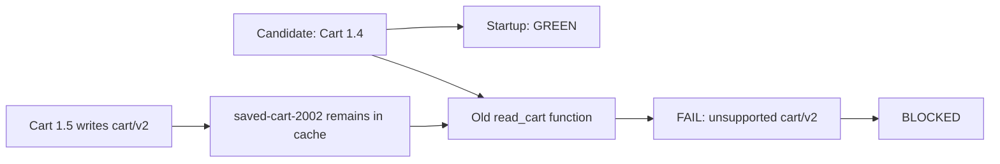
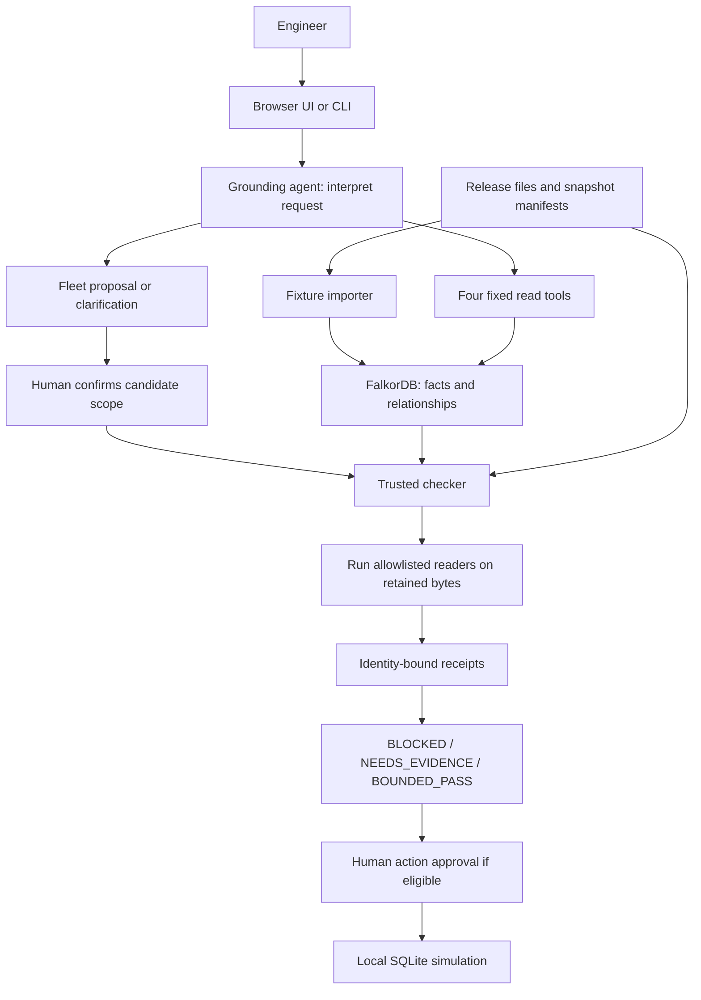
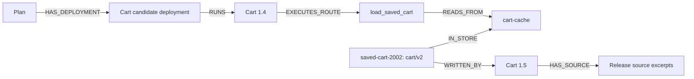
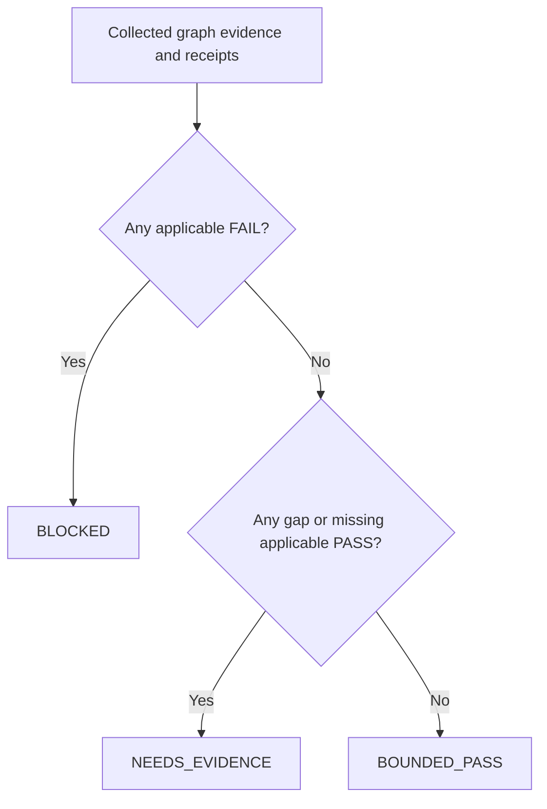
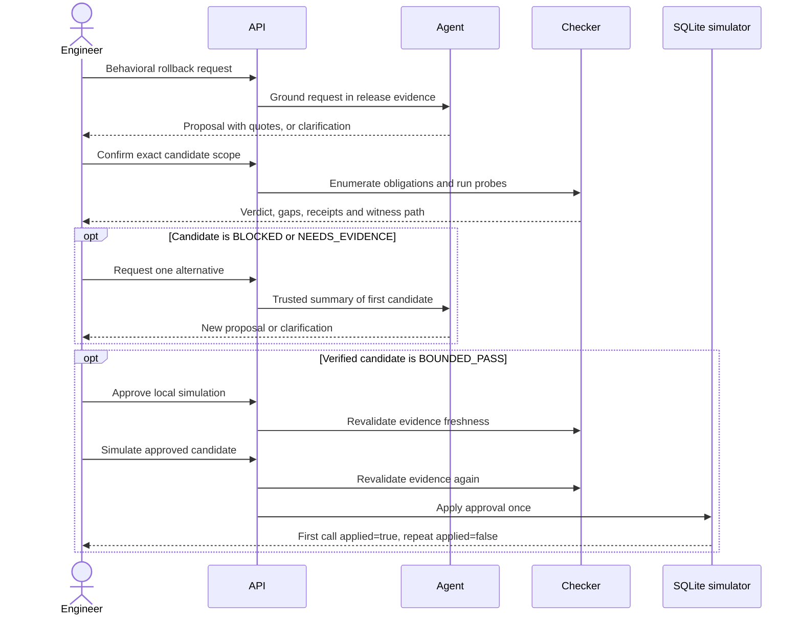

# RollbackWitness: a practical project guide

Study date: 2026-10-16. Source checkout: `771ce3814e7ad8bb6c5902e4ac9de83a711abbee` on `main`.

Start here to understand the application. Read [the issue #3 analysis](ISSUE_3_ANALYSIS.md) afterwards for the evaluation problem and possible fixes. This guide describes the inspected implementation; older design documents sometimes still describe it as proposed.

## 1. What problem does it solve?

Rolling back an application changes its code, but usually leaves its stored data in place. Older code can start successfully and then crash when it encounters a record written in a newer format.

RollbackWitness investigates that specific risk. An engineer describes the behavior they want, an AI proposes existing releases, and trusted Python code checks those releases against retained records. The application shows the actual failing reader, record and evidence path when it finds a problem.

The current project is a **synthetic hackathon prototype**. Its releases are small Python files representing Cart and Checkout services. They are not running production microservices. A passing result covers the modeled records' byte/shape readability. Applying a plan writes a local SQLite simulation ledger; it does not deploy software.

## 2. The example that explains the project

The engineer asks:

> Undo the basket rollout, but keep the receipt correction.

The fixture contains these releases:

| Release | Relevant behavior |
|---|---|
| Cart 1.4 | Writes and reads the older `cart/v1` format. |
| Cart 1.5 | Enables baskets through `basket_v2`; reads both `cart/v1` and `cart/v2`. Turning the flag off makes new saves use `cart/v1`. |
| Checkout 2.0 | Older checkout implementation. |
| Checkout 2.1 | Contains the receipt correction and a reader for both saved-cart formats. |

The complete snapshot retains `saved-cart-1001` in `cart/v1` and `saved-cart-2002` in `cart/v2`.

One candidate is Cart 1.4 + Checkout 2.1. Cart 1.4 passes its startup check, but its `read_cart` function rejects the saved `cart/v2` record. The candidate is **BLOCKED**.

A different existing-artifact candidate is Cart 1.5 with `basket_v2=false` + Checkout 2.1. Its readers can still consume the retained newer bytes. In the complete fixture, this candidate can receive **BOUNDED_PASS**. The checker recomputes its evidence; it does not inherit the first candidate's receipts.



Source: [Cart 1.4 codec](../fixtures/shop/releases/cart-1.4/codec.py), [Cart 1.5 codec](../fixtures/shop/releases/cart-1.5/codec.py), [Checkout 2.1 notes](../fixtures/shop/releases/checkout-2.1/CHANGELOG.md), [complete snapshot](../fixtures/shop/snapshots/snap-001/manifest.json).

## 3. What each component does



| Component | Responsibility | Main source |
|---|---|---|
| Grounding agent | Turns a behavioral request into exact release IDs and flags, with source quotes, or asks a question. | [`grounding.py`](../src/rw/grounding.py) |
| Graph layer | Imports fixture facts and runs fixed parameterized queries. | [`graph.py`](../src/rw/graph.py) |
| Contracts | Defines plans, hashes, obligations, receipts and dispositions. | [`contracts.py`](../src/rw/contracts.py) |
| Checker | Compares graph evidence with independently read files and computes the result. | [`verification.py`](../src/rw/verification.py) |
| Probe runner | Executes the trusted fixture readers with bounded time and output. | [`probes.py`](../src/rw/probes.py), [harness](../fixtures/shop/harness/run_reader.py) |
| Investigation loop | Connects grounding, confirmation, verification and at most one alternative. | [`pipeline.py`](../src/rw/pipeline.py) |
| API and UI | Exposes the step-by-step interaction and evidence screen. | [`api.py`](../src/rw/api.py), [`index.html`](../src/rw/static/index.html) |
| Simulator | Records approval and applies each approved simulation once. | [`simulation.py`](../src/rw/simulation.py) |

The AI has four read tools: `current_fleet`, `release_history`, `store_readers` and `get_excerpts`. Its terminal choices are `propose_fleet` and `ask_clarification`. It cannot submit arbitrary Cypher, run arbitrary code, declare a compatibility pass or approve simulation.

## 4. What FalkorDB contributes

FalkorDB stores connected facts: which release a candidate runs, which reader that release executes, which store it reads, which retained records are there, and which release wrote them.



This path drives the checks and explains their results. It is more than a graph drawn after the verdict.

However, graph relationships alone do not establish completeness. A deleted edge could otherwise hide a reader or record. `build_evidence` checks declared routes and snapshot inventories independently against the files. Missing evidence becomes an explicit gap.

The repository also includes a SQL control. Its purpose is to test whether relational joins can reproduce the same obligation sets. A tie is a valid finding; the project does not need SQL to fail.

## 5. Obligations, probes and receipts in plain language

An **obligation** means: “This exact reader, in this candidate, may encounter this exact retained record; check that pair.”

In the complete example, two selected reader routes each read two records, producing four obligations:

| Reader in the candidate | `saved-cart-1001` | `saved-cart-2002` |
|---|---|---|
| Cart 1.4 | PASS | FAIL |
| Checkout 2.1 | PASS | PASS |

A **probe** runs the real fixture reader on the saved bytes. A **receipt** records what happened and binds the result to the obligation's identity.

The binding includes the plan, snapshot manifest, release, codec, route contract, record payload, probe specification and environment. A receipt for a different version or different payload cannot satisfy the current obligation.

Reader failure is different from probe failure:

| Outcome | Meaning |
|---|---|
| PASS | The fixture reader returned the expected dictionary shape. |
| FAIL | The reader ran and raised while decoding the retained bytes. |
| UNKNOWN | The check could not establish readability: timeout, changed input hash, missing file or invalid harness result, for example. |

The harness uses a per-run nonce and a strict result protocol so ordinary reader output is not mistaken for proof. It runs reviewed fixture code in a subprocess; it is not an adversarial-code sandbox.

## 6. How the final result is chosen



Failure takes precedence over missingness: an observed incompatible reader is enough to block a candidate even if other evidence is incomplete.

Examples:

- Cart 1.4 cannot read the newer retained record → `BLOCKED`.
- The selected readers pass, but inventory coverage is partial → `NEEDS_EVIDENCE`.
- The retained record lacks established writer or format evidence → `NEEDS_EVIDENCE`.
- Every modeled obligation has a current applicable PASS and no gaps remain → `BOUNDED_PASS`.

The three fixture snapshots exercise these situations: `snap-001`, `snap-002-partial` and `snap-003-orphan`. Their verdict still depends on the selected fleet; a failing reader can make even an incomplete snapshot `BLOCKED`.

## 7. The user journey and approval boundary



**Scope confirmation** permits checking a candidate. **Action approval** permits its local simulation. They are separate decisions. The alternative must be confirmed and checked too.

Before approval and simulation, the API revalidates the evidence bytes and declarations. Changed evidence requires new verification and approval. The simulation's SQLite transaction provides idempotency. Human identity is a local operator-name guard, not a production authentication system.

## 8. Run the deterministic example on Linux or WSL

From the repository root:

```bash
sh scripts/setup.sh
docker compose up -d
.venv/bin/python -m pytest -q -m "not live"
.venv/bin/python scripts/smoke.py
```

“Not live” excludes model-provider calls, **but many of these tests still need FalkorDB**. A refused connection to `127.0.0.1:6379` means the required server is unavailable; it does not establish a checker defect.

Check the blocked candidate without using an AI model:

```bash
.venv/bin/python scripts/investigate.py --fleet cart=1.4 --confirm-as reviewer
```

Check the known alternative:

```bash
.venv/bin/python scripts/investigate.py \
  --fleet cart=1.5:basket_v2=false --fleet checkout=2.1 --confirm-as reviewer
```

These commands check and save reports; they do not approve simulation. The default CLI session resets/imports its fixture graph, so use the intended local fixture instance.

To open the browser UI:

```bash
.venv/bin/python scripts/serve.py
```

Open `http://127.0.0.1:8000`. Live grounding needs a configured provider key. Replay needs a saved transcript and is labeled as replay. Full platform-specific setup is in [QUICKSTART.md](QUICKSTART.md).

## 9. Understand the evaluation folders

| Evaluation | What it checks |
|---|---|
| [`evals/expected/`](../evals/expected/README.md) | Hand-derived expected outcomes, kept outside application runtime inputs. |
| [`tests/test_acceptance_oracle.py`](../tests/test_acceptance_oracle.py) | Real graph/checker/probe results against eight expected cases. |
| [`evals/relational_control.py`](../evals/relational_control.py) | SQL obligation derivation from the same fixture facts. |
| [`evals/run_grounding_cases.py`](../evals/run_grounding_cases.py) | Live request interpretation across several request types. This is issue #2's separate concern. |
| [`evals/llm_control.py`](../evals/llm_control.py) | A model given all relevant files as plain text and access to the reader probe, without the graph. This is issue #3. |
| [`evals/score_controls.py`](../evals/score_controls.py) | Scores saved control transcripts and product reports against the independent oracle. |

The flat-context control is allowed to tie or outperform the product. It tests the complete workflows: the product uses a deterministic checker, whereas the control asks the model to enumerate probes and state a disposition. This experiment alone cannot isolate a graph-only causal advantage.

## 10. What was checked during this study

See [the study evidence in the issue analysis](ISSUE_3_ANALYSIS.md#study-evidence) for the initial commands and results. That initial study did not run live models. Subsequent authorized implementation and live testing are recorded separately in [the issue #3 fix report](ISSUE_3_FIX_REPORT.md). Historical scores in [STATUS.md](STATUS.md) belong to their recorded earlier runs.

For deeper reading, follow `Session.verify` in [`pipeline.py`](../src/rw/pipeline.py), then `build_evidence` and `dispose` in [`verification.py`](../src/rw/verification.py). The shared data models are in [`contracts.py`](../src/rw/contracts.py). Read [CONTRACTS.md](CONTRACTS.md) for the full field-level contract.
