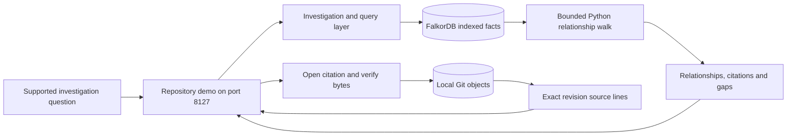
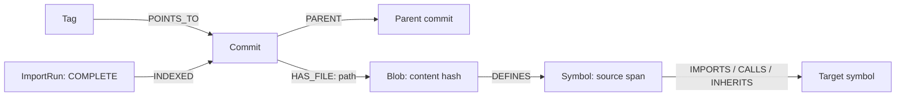

# Demo video recording plan

Record a **five-minute browser walkthrough** using the timecoded flow below.
The [existing talk track](TALK_TRACK.md) provides additional narration examples.
No PowerPoint is needed.
The story is: **follow connected source evidence → verify the citation → catch a
reverted fix → expose evidence gaps**.

The team confirmed five minutes and these target tracks:
**Agents That Act on Connected Data** and **Company Brain**. The supplied
screenshot provides the checklist below; the full rules URL was not supplied.
Track eligibility and event-specific format requirements still need checking.

## What the video demonstrates

Source baseline: `main` at `a8f2224`, reviewed 18 October 2026. The dedicated
repository demo on **8127** is the primary flow for this video. The original
rollback console on **8000** is separate; do not mix their results.

| Workflow | Behavior | Meaning of its result |
| --- | --- | --- |
| Repository evidence demo, `scripts/hackathon_demo.py` | Supported source questions, a real pinned Python repository, and a synthetic Git revert case; deterministic retrieval, no LLM needed | Source relationships, citations, coverage gaps, and source-change presence (`PRESENT` / `ABSENT` / potentially `UNCERTAIN`) |
| Original rollback console, `scripts/serve.py` | A bounded model-driven grounding agent proposes fixture releases; confirmed scope is checked using graph obligations and actual fixture-reader probes | `BLOCKED`, `NEEDS_EVIDENCE`, or `BOUNDED_PASS`; eligible human-approved local simulation is a separate step |



Indexing reads Git objects and extracts source facts; it does not run imported
repository code. The primary demo is **live deterministic graph retrieval**,
not a live model conversation. The real source is ItsDangerous 2.2.0, commit
`096c8d42545d3b68ea21a4f890fb2b2d8979c0bd`. The negative-amount guard example
is **synthetic Git history**, generated by the setup script.

## Track positioning

| Target track | What the video substantiates | Boundary and next step |
| --- | --- | --- |
| Agents That Act on Connected Data | Codebase investigation uses connected facts to select relationships and source evidence to inspect. The wider project also has a bounded grounding agent and trusted rollback checker. | The port-8127 view is deterministic. If judging requires showing model-selected actions, validate and record the separate agent flow below before including it. |
| Company Brain | A narrow engineering-knowledge slice: revision-specific code, definitions, dependencies and Git changes. | This review does not establish a graph spanning people, teams, projects, documents and decisions. Present that broader capability as future work; confirm whether this slice qualifies under the full rules. |

The stronger demonstrated fit is **codebase investigation** in the first track.
Naming both tracks does not establish all their capabilities are implemented.
A proposed Company Brain extension could connect `Person → Team → Project →
Repository`, with documents and decisions linked to commits. That is a proposal,
not the current graph schema.

## Five-minute recording flow

Use these times as rehearsal targets, allowing for clicks and query completion.
This outline is usable without changing the existing talk-track file.

| Time | Screen actions | Narration / point to make |
| --- | --- | --- |
| 0:00–0:30 | Open port 8127; show project name and mode badge | “A fix in Git history can still be missing from the revision we use. RollbackWitness connects code evidence to its exact revision.” |
| 0:30–0:55 | Show the architecture diagram above, then return to app | “FalkorDB connects revisions, file contents and symbols. This view performs live deterministic retrieval; the project's model-driven rollback workflow is separate.” |
| 0:55–1:40 | Ask `What does TimedSerializer depend on?`; click **Investigate →**; then **1 · Explore a real dependency chain** | Follow URLSafeTimedSerializer → TimedSerializer → Serializer. Explain parsed versus inferred edges and the two-hop source trail. |
| 1:40–2:15 | Click a returned source citation; show commit, highlighted lines and verification label; briefly show `content_hash` in raw response | “The citation identifies a commit, file and source span. Opening it verifies the bytes against the recorded hash.” |
| 2:15–3:05 | **2 · Inspect the fix**, then **3 · Catch the reverted fix**; show the source in both | “This Git history is synthetic. The guard is PRESENT at the fixed revision and ABSENT after the revert, although ancestry remains YES.” |
| 3:05–3:40 | **4 · Exhaust the result page**, then **5 · Ask for missing evidence** | Show truncation and the unknown-symbol gap. “An omitted result is not proof of absence; missing source stays unresolved.” |
| 3:40–4:15 | Return to a successful dependency result; show the schema and Cypher section below | Explain that Cypher retrieves facts, Python performs the bounded walk, and Git supplies source bytes. |
| 4:15–4:45 | Show the track table, then return to the app | Name both target tracks. Present codebase investigation as the direct fit and Company Brain as a limited engineering-knowledge slice; people/team/decision links are future work. |
| 4:45–5:00 | End on successful live result with repository and setup links | “Live retrieval, verifiable citations and explicit limits. Our project links include source, queries and local setup.” |

The fixed source contains `if amount < 0: raise ValueError("negative amount")`;
the reverted source only returns the amount. This is a content-presence check,
not a runtime safety proof. Do not claim an accuracy or cost advantage over
plaintext. If a displayed result differs, investigate before narrating it.

## Prepare before recording

### Current machine check

During this documentation pass:

- Python 3.12.14 and imports of `falkordb`, `fastapi` and `uvicorn` succeeded in
  `.venv`.
- Nothing answered at `http://127.0.0.1:8127`.
- `artifacts/repos/itsdangerous`, `artifacts/hackathon-demo/cases.json` and
  `artifacts/hackathon-demo/backup.json` were absent. Pulling the repository does
  not create these local demo artifacts.
- An authenticated GitHub lookup reported **`private: true`** for
  `Ep1cGaimer/FalkorDB_agent`. The screenshot requires public source. The owner
  must resolve publication and verify signed-out access before submission.

These are preparation observations, not a fresh successful end-to-end rehearsal.
No model requests, demo indexing or service startup were performed for this
documentation task. Historical verification in [STATUS.md](STATUS.md) is separate.

### Linux / WSL setup

Run from the repository root. Prerequisites: Git, Docker with a running daemon,
and `uv` on PATH. The existing setup script selects Python 3.12 and installs
pinned dependencies; it can download Python and packages.

```sh
sh scripts/setup.sh
mkdir -p artifacts/repos
# Only clone if artifacts/repos/itsdangerous does not already exist:
git clone --bare https://github.com/pallets/itsdangerous.git artifacts/repos/itsdangerous
```

Use the isolated demo database from [HACKATHON.md](HACKATHON.md). Inspect whether
it already exists:

```sh
docker ps -a --filter name=rw-hackathon-demo-20261018
```

If the named container exists and is stopped, start it and check its mapping:

```sh
docker start rw-hackathon-demo-20261018
docker port rw-hackathon-demo-20261018 6379
```

If it does not exist, create it with the pinned image and a fixed local port:

```sh
docker run -d --name rw-hackathon-demo-20261018 --memory=2g \
  -p 127.0.0.1:55688:6379 \
  falkordb/falkordb@sha256:107455e862a824e45e8e9f5a7fbfdf5e00a08b14e13eae2577c72fd9e3f59ba6
```

If 55688 is occupied by a different service, choose a free fixed port and replace
it in the mapping and every `RW_FALKORDB_PORT` below. Verify an existing
container's mapping. These commands target the dedicated demo container, not the
user's other FalkorDB instances.

After the database responds with `PONG`, initialize the demo indexes and generate
a smoke receipt plus explicit backup:

```sh
docker exec rw-hackathon-demo-20261018 redis-cli ping
RW_FALKORDB_PORT=55688 .venv/bin/python scripts/hackathon_demo.py setup
RW_FALKORDB_PORT=55688 .venv/bin/python scripts/hackathon_demo.py smoke
RW_FALKORDB_PORT=55688 .venv/bin/python scripts/hackathon_demo.py serve --port 8127
```

Leave that terminal running and open `http://127.0.0.1:8127`. No Groq or other
provider key is needed. Do not put keys in commands or show `.env` on camera.
On Windows, use the existing PowerShell setup and `.venv\Scripts\python.exe`,
setting `RW_FALKORDB_PORT` in that shell.

Setup writes the dedicated graphs `rw_hackathon_demo_real` and
`rw_hackathon_demo_trap`, import metadata, and the synthetic Git history. Run it
before recording. Keep the bare clone available: citation verification reads its
Git objects. Investigation receipts go to `artifacts/hackathon-demo/runs/`;
`smoke` writes `smoke-*.json` and refreshes `backup.json`.

### Rehearsal checklist

After `smoke` reports `PASS`, check these in the browser:

| Action | Required visible result |
| --- | --- |
| Ask `What does TimedSerializer depend on?` | Completed live query, citations and a receipt |
| **Explore a real dependency chain** | URLSafeTimedSerializer two-hop relationships; parsed/inferred legend and selected revision |
| Open a returned source citation | Highlighted source, full commit, `SHA256 verified`; `content_hash` in raw response |
| **Inspect the fix** | `PRESENT`, ancestry `YES`, negative-amount guard in `validation.py` |
| **Catch the reverted fix** | `ABSENT`, ancestry still `YES`, guard absent |
| **Exhaust the result page** | One relationship plus explicit truncation |
| **Ask for missing evidence** | Gap for `NoSuchDemoSymbol`, no invented source support |
| **Open recorded backup · NOT LIVE** | Recorded dependency response and working saved source snapshots |
| Return to **Explore a real dependency chain** | New completed live result and receipt; finish rehearsal in live mode |

Do one spoken five-minute rehearsal with a stopwatch. Existing automated records
do not establish narration timing. Keep query delays visible or caption removed
waiting time.

## Graph model and query to show

This is a simplified **repository index** schema, separate from the original
rollback fixture graph:



`Repository` metadata identifies the complete published import and generation.
The diagram omits metadata and release-note nodes for readability. Citations
bind repository, commit, path, line range and file-content hash. Relationships
retain parsed/inferred provenance and extractor identity.

This is the relationship-loading Cypher excerpt from
[`RepoQuery._load`](../../src/rw/repo/query.py). `$hs` is a batch of file-content
hashes from the selected revision's file map:

```cypher
MATCH (b:Blob)-[:DEFINES]->(s:Symbol)-[e]->(t:Symbol)
WHERE b.content_hash IN $hs
RETURN b.content_hash, s.qualname, s.first_path,
       type(e), t.qualname, t.external,
       e.provenance, e.extractor, e.relative_target
```

Cypher retrieves facts; `RepoQuery._walk` resolves adjacency and performs a
bounded breadth-first walk in Python. The demo requests up to **two hops**. Do
not describe the entire investigation as one Cypher traversal. Fix status uses
Git diffs, ancestry and verified selected-revision contents in
`RepoQuery.fix_status`; it does not execute the guard example as a runtime test.

## Screen arrangement and export

Prepare three tabs or rendered views:

1. Working app at `http://127.0.0.1:8127`.
2. This plan rendered at the architecture / graph-model sections.
3. Project README and setup links for the closing shot.

Record at 1920×1080 if available. Make text readable, close unrelated tabs, hide
notifications and keep the cursor still during explanations. Test a ten-second
clip for microphone level and source readability. A narrator and separate
operator can use the same script, or one person can do both.

Suggested captions: `LIVE · deterministic retrieval`, `REAL SOURCE · pinned
revision`, `SYNTHETIC GIT HISTORY`, and, if applicable, `RECORDED BACKUP · NOT LIVE`.
Keep the app mode badge, status and citations visible.

Export `rollbackwitness-demo-5min.mp4` and prepare its shareable URL. Put the repo
URL, setup link, track names and any replay disclosure in the description. Check
the full rules for format/hosting requirements. Watch the exported file from
start to finish and test the final video URL signed out.

## Recovery

| Problem | Response |
| --- | --- |
| Live request fails | Show failure. Check the dedicated DB and port, restore it, and retry. Do not present the previous result as the new response. |
| Need prepared backup | Explicitly click **Open recorded backup · NOT LIVE** and say: “This is a recorded development run with saved source snapshots.” The web server must still run. |
| Backup absent | Restore the live DB and successfully run `smoke` before trying again. |
| Citation verification fails | Stop the take and investigate. Do not claim source verification succeeded. |
| GitHub unavailable | Show verified local source; opening the external revision is optional. |
| Slow query | Wait. Caption any wait removed later; do not claim the edit represents measured latency. |

The backup covers the real dependency response and its sources, **not the entire
fix/revert and coverage sequence**. Restore the live DB for those scenes.

## Optional agent footage

If judging requires a model selecting tools, the separate rollback workflow is
a possible replacement segment **after successful rehearsal**. Follow
[QUICKSTART.md](../QUICKSTART.md) and [UI.md](../UI.md), using its fixture DB
configuration and port-8000 console, rather than the repository demo database.

Useful sequence: behavioral rollback request → agent's cited release proposal →
**Confirm & run checks** → startup success versus actual fixture-reader failure
→ request and independently check the alternative. Human approval and local
simulation are separate. Shop data is synthetic; `BOUNDED_PASS` covers modeled
readability, not production safety. Label a saved model transcript as replay.

This needs its own provider and run check; do not promise a particular live agent
proposal based on source alone. To keep five minutes, shorten the diagram/track
discussion and replace the overview with rehearsed agent footage. Measure the
revised cut before recording.

## Submission checklist from the screenshot

| Requirement | Material / remaining action |
| --- | --- |
| Public source | [Project repo](https://github.com/Ep1cGaimer/FalkorDB_agent) reported private during this pass. Owner must resolve publication and check signed-out access. Visibility was not changed. |
| README, setup and graph model | [README](../../README.md) and [QUICKSTART](../QUICKSTART.md) cover the original app; this plan supplies the repository-demo setup and schema. Adding a README link to this plan is a separate follow-up. |
| Cypher or graph algorithms | Query above, [`repo/query.py`](../../src/rw/repo/query.py), [`repo/index.py`](../../src/rw/repo/index.py), [original architecture](../ARCHITECTURE.md). |
| Working-project video | Record and export the script. This documentation task did not record a video. |
| Deployment or complete local setup | Local instructions above; clean-machine setup still needs rehearsal. The demo binds to loopback; no public deployment is established. |
| Track being entered | Both team-specified tracks, with the scoped positioning above; verify full entry rules. |

## Source map for checking narration

| Claim | Source |
| --- | --- |
| Controls, labels, error clearing and mode badges | [`repository-demo.html`](../../src/rw/static/repository-demo.html) |
| Real commit, synthetic guard/revert, two-hop request, ten-second retrieval budget, zero LLM tokens | [`hackathon_demo.py`](../../scripts/hackathon_demo.py): `setup`, `_investigate`, `smoke` |
| Supported deterministic questions | [`repo/investigate.py`](../../src/rw/repo/investigate.py) |
| Relationship retrieval, walk, source verification, fix presence | [`repo/query.py`](../../src/rw/repo/query.py) |
| Index schema and extraction provenance | [`repo/index.py`](../../src/rw/repo/index.py) |
| Separate model loop and original rollback pipeline | [`grounding.py`](../../src/rw/grounding.py), [`pipeline.py`](../../src/rw/pipeline.py), [UI guide](../UI.md) |
| Prior verification and limits | [STATUS](STATUS.md), [claim card](CLAIMS.md), [launch notes](HACKATHON.md) |

Validation for this documentation change: narration and controls source-checked;
relative file links checked locally; runtime dependency imports checked. Setup
and the full narrated sequence were not executed in this pass. Application code
was not changed.
