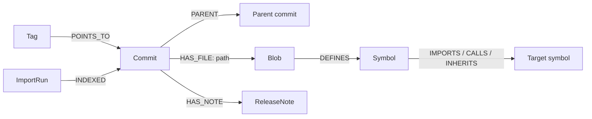

# Repository evidence workflow — demo and graph model

A secondary workflow of RollbackWitness: deterministic (no LLM) source and Git-history retrieval over FalkorDB with verifiable citations. Requirements: [REQUIREMENTS.md](REQUIREMENTS.md); design: [DESIGN.md](DESIGN.md).

## Run the demo

A separate, deterministic workflow that indexes real Git history into FalkorDB and answers dependency and fix-presence questions with verifiable source citations. No model is involved. It uses its own database on port 55688, separate from the fixture database on 6379. If that container already exists, start it with `docker start rw-hackathon-demo-20261018` instead of creating it.

```sh
sh scripts/setup.sh
mkdir -p artifacts/repos
git clone --bare https://github.com/pallets/itsdangerous.git artifacts/repos/itsdangerous
docker run -d --name rw-hackathon-demo-20261018 --memory=2g \
  -p 127.0.0.1:55688:6379 \
  falkordb/falkordb:6.0.2@sha256:107455e862a824e45e8e9f5a7fbfdf5e00a08b14e13eae2577c72fd9e3f59ba6
docker exec rw-hackathon-demo-20261018 redis-cli ping   # wait for PONG
RW_FALKORDB_PORT=55688 .venv/bin/python scripts/hackathon_demo.py setup
RW_FALKORDB_PORT=55688 .venv/bin/python scripts/hackathon_demo.py smoke
RW_FALKORDB_PORT=55688 .venv/bin/python scripts/hackathon_demo.py serve --port 8127
```

Open `http://127.0.0.1:8127` and ask **What does TimedSerializer depend on?** Then try **Explore a real dependency chain**, open a source citation, and compare **Inspect the fix** with **Catch the reverted fix**. The source is ItsDangerous pinned to commit `096c8d42545d3b68ea21a4f890fb2b2d8979c0bd`; the reverted-fix example uses explicitly synthetic Git history. Setup generates local indexes that are not part of the repository. Stop the database with `docker stop rw-hackathon-demo-20261018`.

## Graph model

Implemented by [`src/rw/repo/index.py`](../../src/rw/repo/index.py) and [`src/rw/repo/query.py`](../../src/rw/repo/query.py). The demo uses the graphs `rw_hackathon_demo_real` and `rw_hackathon_demo_trap`; other repository imports default to `rw_repo_<config.name>`.



| Node | Important properties / purpose |
| --- | --- |
| `Repository` | Name, local Git path, status, generation and published import ID; metadata governs which import is usable |
| `ImportRun` | ID, repository, status, timestamps and metrics; only the current complete import is queried |
| `Commit` | Full SHA, repository and commit metadata; `PARENT` points to earlier commits |
| `Tag` | Name and message; an alias pointing to a commit, not an immutable identity |
| `Blob` | SHA-256 content hash, Git blob identity and extraction metadata; `HAS_FILE.path` gives the revision-specific path |
| `Symbol` | ID, qualified name, kind and source span for definitions; unresolved external targets may have no local definition |
| `ReleaseNote` | ID, path and content hash for configured release-note files |

`IMPORTS`, `CALLS` and `INHERITS` edges record provenance and extractor identity, and parsed relationships are labeled separately from statically inferred ones. A citation contains repository, commit, path, line range and content hash, and opening it verifies the Git bytes. Example: follow `URLSafeTimedSerializer → TimedSerializer → Serializer` at the pinned revision. The relationship walk is static; it makes no claim about runtime dispatch or behavioral compatibility.
